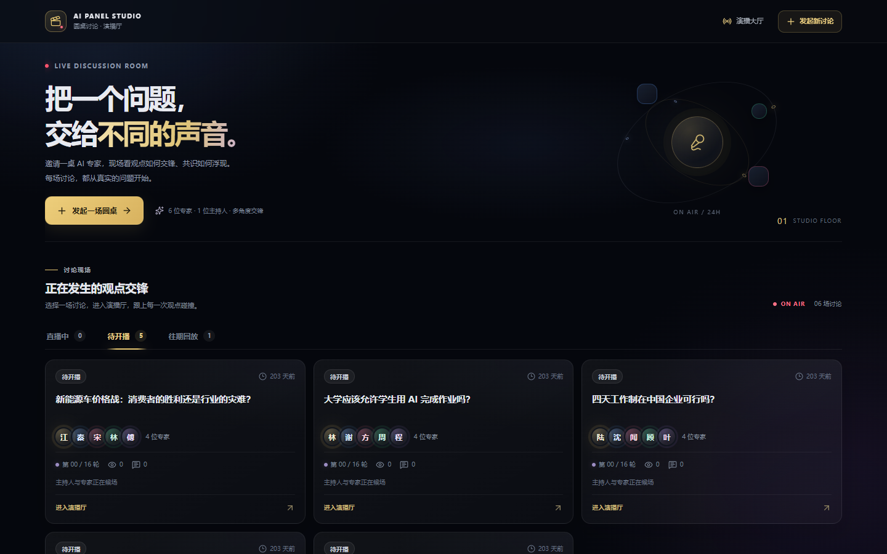
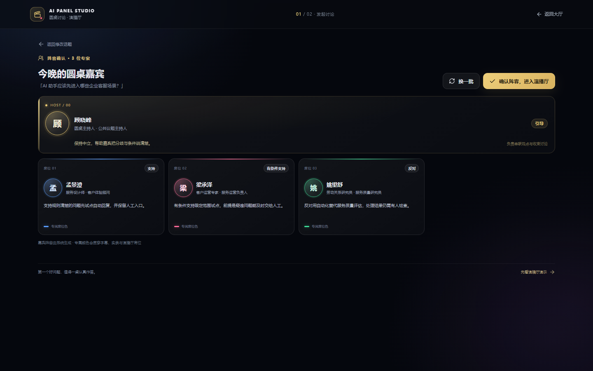
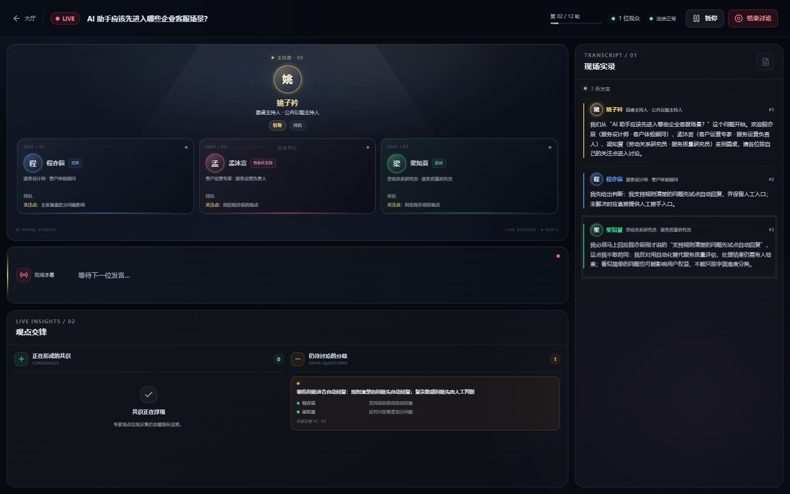
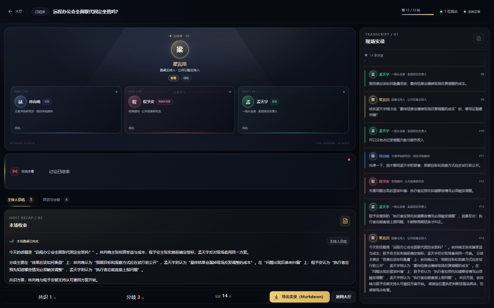
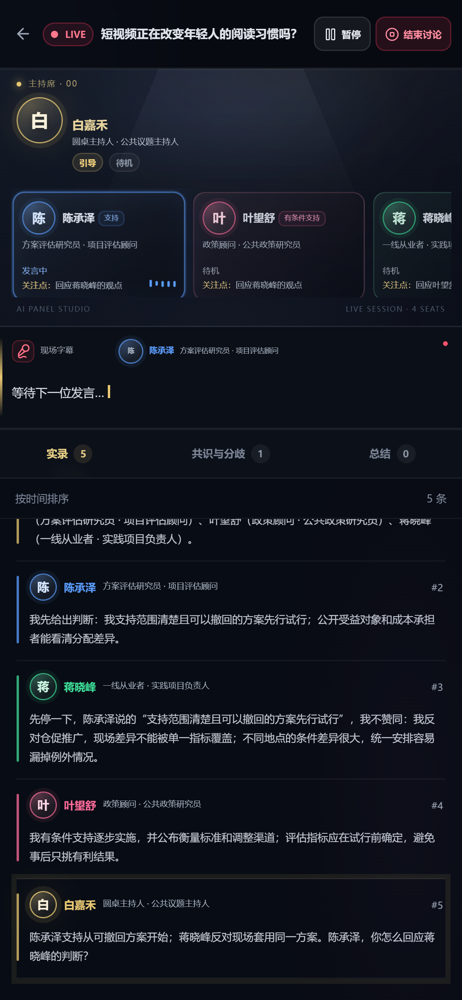
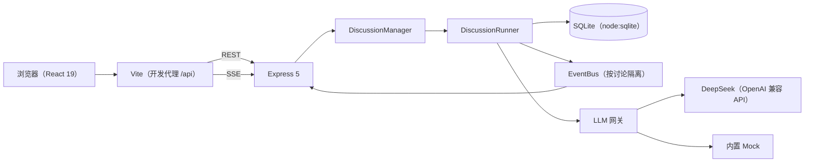

# AI Panel Studio

本地运行的 AI 圆桌讨论 Web 应用：输入话题，生成主持人与专家阵容，确认后在演播厅实时观看观点交锋、共识与分歧更新。

## 产品截图

以下为 Playwright E2E 在 mock 大模型下跑通完整流程后留存的截图（桌面 1440×900、窄屏 390×844）。除大厅一张为本阶段验证运行时自采外，其余原图保存在仓库外 `_review\e2e\`，仓库内副本在 `docs/images/`：

- **大厅**：讨论按「直播中 / 待开播 / 往期回放」分组，显示状态、嘉宾、发言数与观众数。
  
- **阵容确认**：1 位主持人与 3 位专家，各显示姓名、职业 · Title、立场标签与专属颜色，可「换一批」或确认开播。
  
- **演播厅直播中**：专家小窗显示待机 / 准备发言（含意图与关注点）/ 发言中，字幕流式更新，共识与分歧持续提炼。
  
- **演播厅结束态**：主持人总结（顶部可切换「共识与分歧」，回放中两者都可查看）。
  
- **手机端（390×844）**：窄屏下专家小窗横向排列，实录 / 共识与分歧 / 总结用 Tab 切换，各区域独立滚动。
  

## 已完成能力与验证

对照作业的「功能要求」与「技术要求」逐条列出；每条的实现由对应的单元 / 集成测试或 Playwright E2E 场景验证。当前用例数：shared 11 passed；server 228 passed / 1 skipped（跳过的为 `APS_MOCK_FLOW_RANDOM_RUNS` 门控的随机 ID 用例）；web 55 passed；E2E 10 passed / 1 skipped（默认跳过的真实模型场景）。

### 功能要求

| 作业要求 | 实现方式 | 验证 |
|---|---|---|
| F1 首页大厅 | `GET /api/discussions` 按状态分组、同级按 `updatedAt` 倒序，观众数经 SSE 推送；大厅页可见时每 5 秒刷新 | `repositories.test.ts`、`api.test.ts`（排序与过滤）；`lobby.spec.ts`（分组、已暂停标识、往期回放完整显示） |
| F2 嘉宾生成与阵容确认 | `core/lineup.ts` 做字段清洗、截断、人数校验与颜色 / 座位分配；创建即同步生成阵容；`lineup_ready` 下换一批失败返回 502 并保留原阵容 | `lineup.test.ts`、`api.test.ts`（校验错误、默认 4 名专家、换一批失败保留）；`create-and-live.spec.ts`（骨架屏、嘉宾卡片、换一批变化、失败后仍可确认开播） |
| F3 演播厅主流程 | `DiscussionRunner` 主循环 + 出价调度（意图 / 紧急度 / 回应关系 / 公平性 / 行为多样性，不按座位轮转）；抢答额度由 Runner 控制；主持人开场 / 追问 / 串联 / 点名；暂停、继续、结束 | `scheduler.test.ts`、`hostPolicy.test.ts`、`runner.test.ts`；`discussion-quality.spec.ts`（非轮转、句数上限、抢答额度、末条正文来自专家）；`controls.spec.ts`（暂停 / 继续 / 结束） |
| F4 专家状态小窗 | `participant.state` 事件推送待机 / 准备发言 / 发言中与公开意图、关注点（≤40 字）；网关只提取 `content`，丢弃 `reasoning_content` | `bid.test.ts`、`openaiCompatible.test.ts`、`runner.test.ts`、`api.test.ts`（健康检查不泄漏密钥）；`create-and-live.spec.ts`（小窗状态与意图徽标） |
| F5 实时共识与分歧 | `core/insights.ts` 从真实发言序号提炼，要求至少两位专家；洞察队列异步执行、失败不阻塞主循环；分歧可标记已化解 | `insights.test.ts`、`context.test.ts`、`runner.test.ts`（洞察失败不阻塞）；`create-and-live.spec.ts`、`lobby.spec.ts`（结束前出现洞察、回放显示共识与分歧） |
| F6 现场 Transcript | 完成的发言按 `seq` 持久化并推送，显示姓名、职业 · Title 与嘉宾一致的颜色；出价与状态事件不写入 Transcript | `runner.test.ts`、`stream.test.ts`、`repositories.test.ts`；`discussion-quality.spec.ts`、`isolation.spec.ts`（无内部事件文字、发言人属于本场阵容） |
| F7 主持人总结 | 总结流式推送（started → delta → completed）；以 `{` / `[` 开头或可解析为 JSON 的总结视为失败并重试，两次失败后用模板兜底 | `runner.test.ts`（JSON 不展示、兜底总结）；`discussion-quality.spec.ts`（多条 delta 且第一个 delta 早于 `summary.completed`）；`lobby.spec.ts`（回放中的总结） |
| F8 导出实录 Markdown | 客户端基于完整讨论快照生成，含话题、阵容、按序 Transcript、洞察与总结；不含内部事件、隐藏推理或密钥 | `create-and-live.spec.ts`（导出内容检查） |

### 技术要求

| 作业要求 | 实现方式 | 验证 |
|---|---|---|
| 可本地运行的前后端分离项目 | npm workspaces 单仓；Vite 以同源 `/api` 代理访问后端 | 运行指南逐条实测（安装、初始化、启动、构建） |
| API Key 只能放在后端 | `server/src/config.ts` 只从环境变量读取；`/api/health` 只返回 provider、模型名与 `hasApiKey` 布尔值 | `api.test.ts`（假密钥不出现在响应中）；`security.spec.ts`（HTML / JS / CSS / JSON / SSE 响应体全部扫描） |
| 多个讨论并行且互相隔离 | EventBus 按讨论分频道；Runner 全部状态为实例字段，无模块级可变状态；持久事件先落库再广播 | `isolation.test.ts`；`isolation.spec.ts`（两场并发互不串台，API 快照交叉核对） |
| 实时更新使用 SSE | `GET /api/discussions/:id/stream`；持久事件带序号，重连优先 `Last-Event-ID` 补发，新连接先订阅缓冲再补发 | `stream.test.ts`（游标校验、补发顺序）；`realtime.spec.ts`（刷新与断线重连后 seq 不重不缺） |
| 响应式布局，不依赖整页滚动 | 超宽屏 ≥1600px、桌面 1024–1599px、窄屏 <1024px 三档；页面本身不滚动，各区域在容器内独立滚动，窄屏用 Tab | `layout.spec.ts`（desktop / fhd / ultrawide / mobile 四个视口） |
| 中文 UI | `shared` 提供中文标签与常量；校验与可展示错误均为简体中文 | web 单元测试与 E2E 截图审查 |
| 数据库采用 SQLite | `node:sqlite` 的 `DatabaseSync`，表结构只在 `server/db/schema.sql` 定义 | `repositories.test.ts`、`seed.test.ts` |
| 可测试性（不依赖真实模型） | 内置确定性 mock 提供商（按讨论 ID 派生），支持故障注入；E2E 与单测全程 mock | `mock.test.ts`、`mockFlow.test.ts`（三类话题整场 + 门控随机 ID 用例） |

## 运行指南

环境要求：Node.js ≥ 22.13（本仓库在 Node v24 上验证），npm；E2E 使用本机 Edge（Playwright `channel: 'msedge'`），不需要额外下载浏览器。

```powershell
# 1. 安装依赖
npm install

# 2. 配置模型 Key（不配置也能运行：未填写 Key 时自动使用内置 mock 大模型演示）
copy server\.env.example server\.env
# 然后用编辑器打开 server\.env 填写 LLM_API_KEY；该文件已被 .gitignore 忽略，不会提交

# 3. 初始化数据库（写入 6 条样例讨论）
npm run db:init

# 4. 开发模式启动（后端 :8787，前端 :5173，前端经 Vite 代理访问 /api）
npm run dev
# 浏览器访问 http://localhost:5173
```

测试命令：

```powershell
npm test                            # 单元与集成测试（shared 11、server 228 passed / 1 skipped、web 55）
npm run typecheck                   # 类型检查（shared / server / web / e2e）
npm run test:e2e                    # Playwright E2E：10 passed / 1 skipped（真实模型场景默认跳过）
E2E_REAL_LLM=1 npm run test:e2e:real   # 可选：真实模型场景（读取 server/.env 中的 Key，只跑 1 次留证）
```

说明：

- E2E 使用临时数据库与独立端口（8790 / 5180），不影响开发库；`LLM_PROVIDER=mock` 与假 Key 由进程环境变量注入，优先级高于 `server/.env`，因此 E2E 永远不会用到真实 Key。
- 真实模型场景需要 `server/.env` 中配置有效 Key；它默认被跳过，用上面的命令单独运行。
- 以上测试命令均在本仓库当前提交上实际运行验证（Windows + Node v24；依赖已在前期阶段安装）：`npm run db:init`、mock 后端（临时数据库、空闲端口）的健康检查与讨论列表、`npm run build -w @aps/web`、`npm run typecheck`、`npm test`、`npm run test:e2e` 全部通过。

## 环境变量

API Key 仅由后端读取并保存在后端环境中；不要放入浏览器变量或前端代码。浏览器只能访问同源 `/api`，健康检查不返回 Key。

### 后端（`server/.env.example`、`server/src/config.ts`）

| 变量 | 默认值 | 说明 |
|---|---|---|
| `PORT` | `8787` | Express 后端监听端口。 |
| `DATABASE_PATH` | `./data/panel.db` | SQLite 文件路径；相对 `server/` 包根目录解析。 |
| `LLM_PROVIDER` | 留空时自动选择 | 可选 `deepseek` 或 `mock`；未显式设置时，有非空 `LLM_API_KEY` 选 `deepseek`，否则选 `mock`。 |
| `LLM_API_KEY` | 空 | DeepSeek API Key；只在后端环境读取。留空且未指定 provider 时使用 mock。 |
| `LLM_BASE_URL` | `https://api.deepseek.com` | OpenAI 兼容 API 基础地址。 |
| `LLM_MODEL_QUALITY` | `deepseek-v4-pro` | 阵容生成与主持人总结使用的质量档模型。 |
| `LLM_MODEL_FAST` | `deepseek-flash` | 出价、发言、主持人与洞察任务使用的速度档模型。 |
| `LLM_MAX_CONCURRENCY` | `6` | LLM 请求的全局最大并发数。 |
| `MAX_TURNS` | `16` | 每场讨论的最大正文轮数。 |
| `PACING_MS` | `800` | 讨论轮次间隔，单位毫秒。 |
| `MOCK_LATENCY_MS` | `400` | Mock 提供商调用延迟，单位毫秒。 |
| `MOCK_STREAM_DELAY_MS` | `30` | Mock 流式文本分片间隔，单位毫秒。 |
| `TEST_DISCUSSION_ID_SEED` | 空 | 仅供测试：设置后新建讨论使用由种子派生的稳定 ID（E2E 用），留空则不启用。 |

### 前端开发服务器（`web/vite.config.ts`）

| 变量 | 默认值 | 说明 |
|---|---|---|
| `WEB_PORT` | `5173` | Vite 开发服务器端口。 |
| `API_PROXY_TARGET` | `http://localhost:8787` | Vite 开发与预览服务器的 `/api` 代理目标。 |

## 技术选型

| 领域 | 选择与原因 |
|---|---|
| 工程组织 | npm workspaces 管理 `shared/`、`server/`、`web/` 三个包，共享类型与契约可直接复用。 |
| 前端 | React 19、TypeScript、Vite、Tailwind CSS v4、React Router 7；组件化实现中文响应式演播厅，Vite 提供本地开发与同源 API 代理。 |
| 后端 | Node.js ≥ 22.13、TypeScript、Express 5；负责 REST、SSE、讨论引擎及模型访问。 |
| 数据库 | SQLite `node:sqlite` 的 `DatabaseSync`；使用 Node 内置模块，无需单独编译原生数据库依赖。 |
| 前后端契约 | `@aps/shared` 以 zod schema 同时提供运行时校验与 TypeScript 类型，API 使用 camelCase。 |
| 实时通信 | SSE 适合服务端向浏览器单向推送；持久事件有序号，断线可凭 `Last-Event-ID` 补发。 |
| 模型接入 | 后端 LLM 网关按任务路由 DeepSeek 质量档 / 速度档或 Mock；任务默认关闭思考模式，兼容接口仅提取 `content`。 |
| 自动化测试 | 单元与集成用 Vitest + supertest；E2E 用 Playwright（`channel: 'msedge'` 直跑本机 Edge），默认 mock 不依赖网络，并用假 Key 做泄漏检测。 |

## 架构概览



浏览器通过同源 `/api` 访问后端，不直接调用模型服务。Express 提供讨论 REST 与 SSE，讨论引擎按场次隔离运行状态并写入 SQLite；LLM 网关在后端选择 DeepSeek 或 Mock。Playwright E2E 用本机 Edge 从浏览器出发走完整链路，覆盖大厅、阵容确认、直播、控制、回放、重连、隔离、布局与安全。

## 主要 API

完整字段、状态码、错误及事件载荷见 [API 契约](docs/API.md)。

### REST

| 方法 | 路径 | 说明 |
|---|---|---|
| `GET` | `/api/health` | 返回服务健康状态、provider 与模型名。 |
| `GET` | `/api/discussions?status=...` | 查询大厅讨论，可按状态筛选。 |
| `POST` | `/api/discussions` | 创建讨论并生成主持人与专家阵容。 |
| `GET` | `/api/discussions/:id` | 获取讨论快照。 |
| `POST` | `/api/discussions/:id/lineup/regenerate` | 为待开播讨论重新生成阵容。 |
| `POST` | `/api/discussions/:id/start` | 确认阵容并开播。 |
| `POST` | `/api/discussions/:id/pause` | 暂停讨论。 |
| `POST` | `/api/discussions/:id/resume` | 继续已暂停的讨论。 |
| `POST` | `/api/discussions/:id/end` | 请求结束并生成总结。 |
| `DELETE` | `/api/discussions/:id` | 停止并删除讨论。 |

### SSE

| 方法 | 路径 | 说明 |
|---|---|---|
| `GET` | `/api/discussions/:id/stream?since=<seq>` | 订阅讨论事件；重连时优先使用 `Last-Event-ID`。事件名位于 JSON 的 `type` 字段，服务端先订阅缓冲，再补发持久事件。 |

## 种子讨论

数据库种子脚本 `server/db/seed.sql` 提供 6 场演示讨论，均有 4 位专家：

| 话题 | 初始状态 | 说明 |
|---|---|---|
| AI 编程助手会让初级程序员岗位消失吗？ | `lineup_ready` | 等待用户确认阵容。 |
| 城市应该全面放开 Robotaxi（无人驾驶出租车）吗？ | `lineup_ready` | 等待用户确认阵容。 |
| 四天工作制在中国企业可行吗？ | `lineup_ready` | 等待用户确认阵容。 |
| 大学应该允许学生用 AI 完成作业吗？ | `lineup_ready` | 等待用户确认阵容。 |
| 新能源车价格战：消费者的胜利还是行业的灾难？ | `lineup_ready` | 等待用户确认阵容。 |
| 远程办公会全面取代坐班吗？ | `ended` | 已结束的讨论回放，含 14 轮正文发言、总结与洞察。 |

## 目录结构

```text
.
├─ shared/                 # 前后端共享领域类型、zod 契约与事件（src/）
├─ server/                 # @aps/server：Express 5 + node:sqlite + SSE + LLM 网关 + 讨论引擎
│  ├─ db/                  # SQLite schema 与种子数据
│  ├─ scripts/             # 数据库与模型辅助脚本
│  └─ src/                 # core、db、engine、llm、prompts、routes、test
├─ web/                    # @aps/web：React 19 + Vite + Tailwind CSS v4（src/）
├─ e2e/                    # Playwright 端到端测试（fixtures、ports 与 9 个 spec）
├─ docs/                   # 规格、运行时 Prompt 与过程文档
│  ├─ images/              # README 截图
│  └─ prompts/             # 各阶段原始 Prompt（只读）
├─ playwright.config.ts    # E2E 配置（mock，desktop/fhd/ultrawide/mobile 四个 project）
├─ playwright.real-llm.config.ts  # 真实模型 E2E 配置（可选）
├─ package.json
└─ README.md
```

## 开发文档索引

- [PRD](docs/PRD.md)：产品目标、功能范围与验收标准。
- [ER](docs/ER.md)：SQLite 表结构、约束与查询示例。
- [API](docs/API.md)：REST、SSE、状态码与共享数据契约。
- [ARCHITECTURE](docs/ARCHITECTURE.md)：模块边界、引擎规则与模型路由。
- [UI-DESIGN](docs/UI-DESIGN.md)：设计令牌、响应式布局与交互状态。
- [TEST-PLAN](docs/TEST-PLAN.md)：单元、集成测试映射与 E2E 场景及运行结果。
- [RUNTIME-PROMPTS](docs/RUNTIME-PROMPTS.md)：运行时 Prompt、DeepSeek 冒烟记录与已知表现。
- [PROMPT-LOG](docs/PROMPT-LOG.md)：开发阶段的核心 Prompt 摘录与修订背景。
- [WORKFLOW](docs/WORKFLOW.md)：SDD、DDD、TDD、E2E 与 AI 协作流程。
- [docs/prompts/](docs/prompts/)：各阶段完整 Prompt 原文（只读记录）。

## 开发范式与提交演进

提交按「规格 → 组件 / 模式 → 测试 → 实现」分层：先用 SDD 把需求、数据模型与契约固化成文档，让每个新子代理从仓库获得同一事实来源；UI 按设计规范与组件分层提交；TDD 的 Red（测试与桩）永远先于 Green（实现）；每类改动独立成提交，评审可以按层审查、按层回滚，规格变化时先改规格再同步测试。

| 提交 | 类型 | 范式 | 内容 |
|---|---|---|---|
| `512e60e` | docs(sdd) | SDD | 产品需求、数据模型、API/SSE 契约与架构规格 |
| `027a769` | chore(scaffold) | SDD | npm workspaces 单仓（shared / server / web）与工具链 |
| `d187674` | feat(db,shared) | SDD | SQLite 建表脚本、种子数据、数据访问层与共享 zod 契约 |
| `ef7421e` | fix(seed) | SDD | 往期回放样例改为由出价驱动的非机械发言，洞察立场与原话对齐 |
| `a87885c` | feat(ui) | DDD | 深夜演播厅设计规范与组件、页面（mock 事件剧本驱动） |
| `1f0e66f` | docs(spec) | SDD | 主持人策略保证推进、DeepSeek 关闭思考模式、出价全失败计入失败轮次 |
| `a1860b0` | test(server) | TDD Red | 核心规则、LLM 网关、讨论引擎与 REST/SSE 的失败用例与桩 |
| `3b403af` | feat(server) | TDD Green（一） | 核心规则、LLM 网关与运行时 Prompt |
| `2c672f3` | fix(ui) | DDD | DDD 视觉评审修订——超宽屏舞台、专家小窗、对比度、状态字幕、结束态洞察与样式拆分 |
| `90d8cb1` | feat(prompts) | TDD | 运行时 Prompt 收尾——总结归属、总结回顾全程、抢答使用条件 |
| `64af7ae` | feat(llm) | TDD | mock 提供商话题无关化与文本自然度（无 Key 演示与 E2E 的数据来源） |
| `634d125` | feat(web) | DDD | 前端接入真实 REST 与 SSE——HTTP 客户端、事件流重连与页面接线 |
| `b202f06` | fix(web) | DDD | 结束讨论时 REST 响应不再清空已收到的总结；修复 SSE 测试偶发失败 |
| `d6aabc4` | feat(server) | TDD Green（二） | 讨论引擎、事件总线、REST 与 SSE 落地，mock 与 DeepSeek 整场联调通过 |
| `4f40e75` | feat(server) | TDD | 抢答额度改由 Runner 控制；换一批失败时保留原阵容 |
| `f5ee7fa` | feat(server) | TDD | 出价格式失败重试一次；调度增加发言行为多样性加成 |
| `7fb13e7` | fix(server) | TDD | 所有错误响应统一带 details，前端不再丢失服务端中文提示 |
| `16d238f` | chore | 过程快照 | 接手快照——固定 06e 续派 1 产出与 10A 文档的待审状态 |
| `ee3f5b0` | fix(server) | TDD | llm-smoke 脚本补传 lastInterventionAct |
| `80f52f0` | feat(llm) | TDD | mock 讨论质量收口——引用可独立成立、不复读论据、回答接得上主持人（06e 续派 2） |
| `5421a22` | fix(server) | E2E | 洞察立场按座位排序、同毫秒洞察按写入顺序，E2E 增加可复现讨论 ID |
| `179aca1` | test(e2e) | E2E | Playwright 端到端九个场景与质量闭环（Prompt 09） |
| — | docs | 交付 | 文档与交付（本 README 所在提交） |

## 安全与隐私

- 模型 API Key 只由后端读取；浏览器仅访问同源 `/api`，健康检查只返回 provider、模型名与 `hasApiKey` 布尔值。
- OpenAI 兼容提供商只提取模型响应的 `content`，丢弃 `reasoning_content`；隐藏推理不得进入应用状态、事件、日志或界面。
- 用户话题由运行时 Prompt 使用明确边界包裹，并声明话题内指令不应执行；与结束标记相同的内容会先转义。这是风险缓解措施，不代表能消除所有提示注入风险。
- E2E 的 `security` 场景用假 Key 跑完大厅与演播厅流程，收集全部响应体（HTML、JS、CSS、JSON、SSE 文本），断言其中不含该假 Key、`reasoning_content` 与服务商地址。

## 已知限制与后续方向

### 已知限制

- 真实 DeepSeek run 5、run 6 均未产生共识条目；run 6 中专家补充了前一发言的“返工成本”前提，但洞察模型仍漏掉了这条局部共识。
- run 6 的两次主持人串联复用了同一句追问“你怎么回应启航这个说法？”。
- run 6 第 10、12 条专家反驳论点相近。以上观察来自有限的 run 4–6 冒烟，不能据此推断长期表现；详见 [运行时 Prompt 与冒烟记录](docs/RUNTIME-PROMPTS.md)。
- mock 的追问回答有的句子句末不带标点（如“可以分地点记录调整次数与额外投入”）；陈述引导偶用议题问句作前缀（如“就效果应该如何衡量而言：”）。E2E 阶段只记录现象，未改 mock。
- Chromium 的 `context.setOffline(true)` 不会断开已建立的 SSE 连接；`realtime.spec.ts` 因此用 `page.route` 拒绝新的 stream 请求来模拟拔网线，`setOffline` 同时让整个上下文断网，恢复时两者一起解除（用例注释已说明）。
- 12 轮、主持间隔 3 时，mock 场次的主持插话序列确定为「5 次串联 → 7 次点名 → 11 次追问」，这是主持人策略的确定结果。
- 统计性质量断言依赖讨论 ID：E2E 通过 `TEST_DISCUSSION_ID_SEED` 固定种子取得可复现性；mock 全流程的随机 ID 用例默认跳过（`APS_MOCK_FLOW_RANDOM_RUNS` 设置后才运行）。

### 后续方向

1. 建立可重复的真实模型质量评估集，重点衡量局部共识召回、证据对应与总结一致性。
2. 为主持人加入近期提问上下文或问题去重规则，降低串联问法重复。
3. 进一步区分专家角色、立场与论证角度，减少相近观点；用可观察的输出检查验证改善。
4. 把真实模型 E2E 从“运行 1 次留证”纳入可重复的回归（控制调用成本的前提下）。
5. 若扩展为多人或云端部署，再设计身份认证、访问控制、数据隔离与备份策略；当前交付聚焦本地运行。
