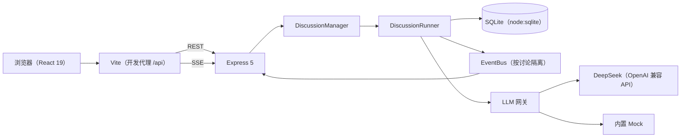

# AI Panel Studio

本地运行的 AI 圆桌讨论 Web 应用：输入话题，生成主持人与专家阵容，确认后在演播厅实时观看观点交锋、共识与分歧更新。

> 产品截图（大厅、阵容确认、演播厅直播、结束回放、窄屏）：（第二部分 B 补齐）

## 已完成能力与验证

（第二部分 B 补齐：逐项对照作业功能/技术要求，并列出对应的单元、集成与 E2E 验证。）

## 运行指南

（第二部分 B 补齐：环境准备、依赖安装、数据库初始化、启动与访问、测试命令及逐项实测结果。本阶段未执行运行指南命令。）

## 环境变量

API Key 仅由后端读取并保存在后端环境中；不要放入浏览器变量或前端代码。

### 后端（`server/.env.example`、`server/src/config.ts`）

| 变量 | 默认值 | 说明 |
|---|---|---|
| `PORT` | `8787` | Express 后端监听端口。 |
| `DATABASE_PATH` | `./data/panel.db` | SQLite 文件路径；相对 `server/` 包根目录解析。 |
| `LLM_PROVIDER` | 留空时自动选择 | 可选 `deepseek` 或 `mock`；未显式设置时，有非空 `LLM_API_KEY` 选 `deepseek`，否则选 `mock`。 |
| `LLM_API_KEY` | 空 | DeepSeek API Key；只在后端环境读取。留空且未指定 provider 时使用 mock。 |
| `LLM_BASE_URL` | `https://api.deepseek.com` | OpenAI 兼容 API 基础地址。 |
| `LLM_MODEL_QUALITY` | `deepseek-v4-pro` | 阵容生成与主持人总结使用的质量档模型。 |
| `LLM_MODEL_FAST` | `deepseek-flash` | 出价、发言、主持人与洞察任务使用的速度档模型。 |
| `LLM_MAX_CONCURRENCY` | `6` | LLM 请求的全局最大并发数。 |
| `MAX_TURNS` | `16` | 每场讨论的最大正文轮数。 |
| `PACING_MS` | `800` | 讨论轮次间隔，单位毫秒。 |
| `MOCK_LATENCY_MS` | `400` | Mock 提供商调用延迟，单位毫秒。 |
| `MOCK_STREAM_DELAY_MS` | `30` | Mock 流式文本分片间隔，单位毫秒。 |

### 前端开发服务器（`web/vite.config.ts`）

| 变量 | 默认值 | 说明 |
|---|---|---|
| `WEB_PORT` | `5173` | Vite 开发服务器端口。 |
| `API_PROXY_TARGET` | `http://localhost:8787` | Vite 开发与预览服务器的 `/api` 代理目标。 |

## 技术选型

| 领域 | 选择与原因 |
|---|---|
| 工程组织 | npm workspaces 管理 `shared/`、`server/`、`web/` 三个包，共享类型与契约可直接复用。 |
| 前端 | React 19、TypeScript、Vite、Tailwind CSS v4、React Router 7；组件化实现中文响应式演播厅，Vite 提供本地开发与同源 API 代理。 |
| 后端 | Node.js ≥ 22.13、TypeScript、Express 5；负责 REST、SSE、讨论引擎及模型访问。 |
| 数据库 | SQLite `node:sqlite` 的 `DatabaseSync`；使用 Node 内置模块，无需单独编译原生数据库依赖。 |
| 前后端契约 | `@aps/shared` 以 zod schema 同时提供运行时校验与 TypeScript 类型，API 使用 camelCase。 |
| 实时通信 | SSE 适合服务端向浏览器单向推送；持久事件有序号，断线可凭 `Last-Event-ID` 补发。 |
| 模型接入 | 后端 LLM 网关按任务路由 DeepSeek 质量档/速度档或 Mock；任务默认关闭思考模式，兼容接口仅提取 `content`。 |
| 自动化测试 | 当前单元与集成测试使用 Vitest、supertest；根包已声明 Playwright 依赖与 `test:e2e` 脚本，E2E 配置和目录待第二部分 B 补齐。 |

## 架构概览



浏览器通过同源 `/api` 访问后端，不直接调用模型服务。Express 提供讨论 REST 与 SSE，讨论引擎按场次隔离运行状态并写入 SQLite；LLM 网关在后端选择 DeepSeek 或 Mock。Playwright E2E 尚未接入当前工作区（第二部分 B 补齐）。

## 主要 API

完整字段、状态码、错误及事件载荷见 [API 契约](docs/API.md)。

### REST

| 方法 | 路径 | 说明 |
|---|---|---|
| `GET` | `/api/health` | 返回服务健康状态、provider 与模型名。 |
| `GET` | `/api/discussions?status=...` | 查询大厅讨论，可按状态筛选。 |
| `POST` | `/api/discussions` | 创建讨论并生成主持人与专家阵容。 |
| `GET` | `/api/discussions/:id` | 获取讨论快照。 |
| `POST` | `/api/discussions/:id/lineup/regenerate` | 为待开播讨论重新生成阵容。 |
| `POST` | `/api/discussions/:id/start` | 确认阵容并开播。 |
| `POST` | `/api/discussions/:id/pause` | 暂停讨论。 |
| `POST` | `/api/discussions/:id/resume` | 继续已暂停的讨论。 |
| `POST` | `/api/discussions/:id/end` | 请求结束并生成总结。 |
| `DELETE` | `/api/discussions/:id` | 停止并删除讨论。 |

### SSE

| 方法 | 路径 | 说明 |
|---|---|---|
| `GET` | `/api/discussions/:id/stream?since=<seq>` | 订阅讨论事件；重连时优先使用 `Last-Event-ID`。事件名位于 JSON 的 `type` 字段，服务端先订阅缓冲，再补发持久事件。 |

## 种子讨论

数据库种子脚本 `server/db/seed.sql` 提供 6 场演示讨论，均有 4 位专家：

| 话题 | 初始状态 | 说明 |
|---|---|---|
| AI 编程助手会让初级程序员岗位消失吗？ | `lineup_ready` | 等待用户确认阵容。 |
| 城市应该全面放开 Robotaxi（无人驾驶出租车）吗？ | `lineup_ready` | 等待用户确认阵容。 |
| 四天工作制在中国企业可行吗？ | `lineup_ready` | 等待用户确认阵容。 |
| 大学应该允许学生用 AI 完成作业吗？ | `lineup_ready` | 等待用户确认阵容。 |
| 新能源车价格战：消费者的胜利还是行业的灾难？ | `lineup_ready` | 等待用户确认阵容。 |
| 远程办公会全面取代坐班吗？ | `ended` | 已结束的讨论回放，含 14 轮正文发言、总结与洞察。 |

## 目录结构

```text
.
├─ shared/                 # 前后端共享领域类型、zod 契约与事件
│  └─ src/
├─ server/
│  ├─ db/                  # SQLite schema 与种子数据
│  ├─ scripts/             # 数据库与模型辅助脚本
│  └─ src/                 # core、db、engine、llm、prompts、routes、test
├─ web/
│  └─ src/                 # api、components、lib、pages、state、styles、test
├─ docs/                   # 规格、运行时 Prompt 与过程文档
│  └─ prompts/             # 各阶段原始 Prompt
├─ package.json
└─ README.md
```

Playwright 配置、`e2e/` 目录及 `docs/images/` 截图资源的最终目录记录：（第二部分 B 补齐；当前工作区尚无 `e2e/` 和 `docs/images/`）。

## 开发文档索引

- [PRD](docs/PRD.md)：产品目标、功能范围与验收标准。
- [ER](docs/ER.md)：SQLite 表结构、约束与查询示例。
- [API](docs/API.md)：REST、SSE、状态码与共享数据契约。
- [ARCHITECTURE](docs/ARCHITECTURE.md)：模块边界、引擎规则与模型路由。
- [UI-DESIGN](docs/UI-DESIGN.md)：设计令牌、响应式布局与交互状态。
- [TEST-PLAN](docs/TEST-PLAN.md)：单元、集成测试映射及待完成的 E2E 场景。
- [RUNTIME-PROMPTS](docs/RUNTIME-PROMPTS.md)：运行时 Prompt、DeepSeek 冒烟记录与已知表现。
- [PROMPT-LOG](docs/PROMPT-LOG.md)：开发阶段的核心 Prompt 摘录与修订背景。
- [WORKFLOW](docs/WORKFLOW.md)：SDD、DDD、TDD、E2E 与 AI 协作流程。
- [docs/prompts/](docs/prompts/)：各阶段完整 Prompt 原文（只读记录）。

## 开发范式与提交演进

（第二部分 B 补齐：待根据真实提交历史整理提交、范式与变更内容。）

## 安全与隐私

- 模型 API Key 只由后端读取；浏览器仅访问同源 `/api`，健康检查只返回 provider 与模型名。
- OpenAI 兼容提供商只提取模型响应的 `content`，丢弃 `reasoning_content`；隐藏推理不得进入应用状态、事件、日志或界面。
- 用户话题由运行时 Prompt 使用明确边界包裹，并声明话题内指令不应执行；与结束标记相同的内容会先转义。这是风险缓解措施，不代表能消除所有提示注入风险。
- 浏览器资源与 API 的密钥泄漏 E2E 检查：（第二部分 B 补齐）。

## 已知限制与后续方向

### 已知限制

- 真实 DeepSeek run 5、run 6 均未产生共识条目；run 6 中专家补充了前一发言的“返工成本”前提，但洞察模型仍漏掉了这条局部共识。
- run 6 的两次主持人串联复用了同一句追问“你怎么回应启航这个说法？”。
- run 6 第 10、12 条专家反驳论点相近。以上观察来自有限的 run 4–6 冒烟，不能据此推断长期表现；详见 [运行时 Prompt 与冒烟记录](docs/RUNTIME-PROMPTS.md)。

### 后续方向

1. 建立可重复的真实模型质量评估集，重点衡量局部共识召回、证据对应与总结一致性。
2. 为主持人加入近期提问上下文或问题去重规则，降低串联问法重复。
3. 进一步区分专家角色、立场与论证角度，减少相近观点；用可观察的输出检查验证改善。
4. 在第二部分 B 补齐 Playwright 闭环测试和浏览器资源/API 的密钥泄漏检查。
5. 若扩展为多人或云端部署，再设计身份认证、访问控制、数据隔离与备份策略；当前交付聚焦本地运行。
