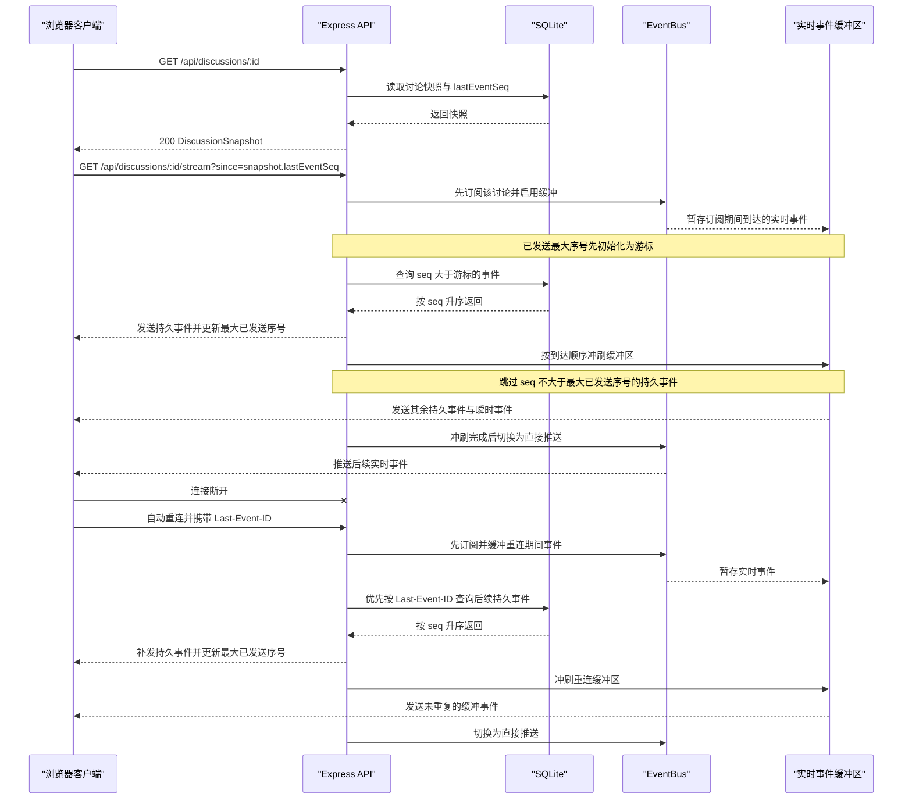

# API 与实时事件契约

- **文档目的：** 固化前后端共享的数据类型、REST 接口、错误响应和 SSE 协议，作为客户端接入与契约测试依据。
- **读者：** 前端开发代理、后端开发代理、集成测试代理。
- **版本：** v1.0
- **关联文档：** `docs/PRD.md`、`docs/ER.md`、`docs/ARCHITECTURE.md`、`docs/prompts/01-sdd-docs.md`

## 1. 通用约定

- **Base URL：** `/api`。本地开发时 Vite 将 `/api` 代理到 `http://localhost:8787`。
- **数据格式：** REST 请求和成功响应使用 JSON，UTF-8；属性名使用 `camelCase`。SQLite 列名使用 `snake_case`，仅在 repository/mapper 层转换。
- **时间：** ISO 8601 字符串。
- **标识符：** UUID 字符串。
- **校验：** 请求体和查询参数须通过契约校验。所有错误 `message` 均为可直接展示的简体中文，不包含堆栈。
- **未预期错误：** 任一接口遇到未预期的内部错误时返回 `500 INTERNAL`。
- **通用错误格式：**

```json
{
  "error": {
    "code": "VALIDATION_ERROR",
    "message": "话题长度需在 2–200 字之间",
    "details": []
  }
}
```

| 错误码 | HTTP 状态 | 含义 |
|---|---:|---|
| `VALIDATION_ERROR` | 400 | 请求参数或请求体未通过校验。 |
| `NOT_FOUND` | 404 | 讨论或指定资源不存在。 |
| `INVALID_STATE` | 409 | 当前讨论状态不允许该操作。 |
| `LLM_ERROR` | 502 | 大模型请求、格式校验或阵容生成失败。 |
| `INTERNAL` | 500 | 未预期的内部错误。 |

## 2. 数据类型

以下 TypeScript 定义由 `@aps/shared` 导出，前后端共同使用。

```ts
type DiscussionStatus =
  | 'draft'
  | 'lineup_ready'
  | 'live'
  | 'paused'
  | 'summarizing'
  | 'ended'
  | 'failed';

type AgentState = 'idle' | 'preparing' | 'speaking';
type BidIntent = 'raise_hand' | 'interrupt' | 'supplement' | 'rebut';
type SpeechAct =
  | 'opening'
  | 'follow_up'
  | 'bridge'
  | 'invite'
  | 'closing'
  | 'statement'
  | 'interrupt'
  | 'supplement'
  | 'rebut';
type InsightKind = 'consensus' | 'divergence';
type InsightStatus = 'active' | 'resolved';

interface Discussion {
  id: string;
  topic: string;
  expertCount: number;
  status: DiscussionStatus;
  maxTurns: number;
  turnCount: number;
  summary: string | null;
  errorMessage: string | null;
  source: 'user' | 'seed';
  createdAt: string;
  updatedAt: string;
  startedAt: string | null;
  endedAt: string | null;
}

interface Participant {
  id: string;
  discussionId: string;
  role: 'host' | 'expert';
  seat: number;
  name: string;
  profession: string;
  title: string;
  stance: string;
  stanceTag: string;
  persona: string;
  color: string;
  avatar: string;
  agentState: AgentState;
  agentIntent: BidIntent | null;
  focus: string | null;
  speakCount: number;
}

interface Utterance {
  id: string;
  discussionId: string;
  participantId: string;
  seq: number;
  act: SpeechAct;
  replyToParticipantId: string | null;
  content: string;
  createdAt: string;
}

interface InsightStance {
  participantId: string;
  position: string;
}

interface Insight {
  id: string;
  discussionId: string;
  kind: InsightKind;
  content: string;
  status: InsightStatus;
  stances: InsightStance[];
  evidenceSeqs: number[];
  updatedAtSeq: number;
  createdAt: string;
  updatedAt: string;
}

interface LiveUtterance {
  utteranceId: string;
  participantId: string;
  act: SpeechAct;
  replyToParticipantId: string | null;
  seq: number;
  text: string;
}

interface DiscussionSnapshot {
  discussion: Discussion;
  participants: Participant[];
  utterances: Utterance[];
  insights: Insight[];
  liveUtterance: LiveUtterance | null;
  lastEventSeq: number;
  viewerCount: number;
}

interface ParticipantBrief {
  id: string;
  role: 'host' | 'expert';
  name: string;
  title: string;
  color: string;
  avatar: string;
}

interface DiscussionListItem {
  id: string;
  topic: string;
  status: DiscussionStatus;
  expertCount: number;
  maxTurns: number;
  turnCount: number;
  source: 'user' | 'seed';
  createdAt: string;
  updatedAt: string;
  participants: ParticipantBrief[];
  utteranceCount: number;
  viewerCount: number;
  latestUtterance: { speakerName: string; content: string } | null;
}
```

`DiscussionSnapshot.liveUtterance` 是内存态的当前流式发言，供中途加入的观众显示正在生成的字幕；没有则为 `null`。

## 3. REST 接口

### 3.1 `GET /api/health`

- **说明：** 健康检查。仅返回提供商名和模型名，绝不返回 API Key。
- **请求：** 无参数、无请求体。
- **成功响应：** `200 OK`

```json
{
  "ok": true,
  "llm": {
    "provider": "deepseek",
    "qualityModel": "deepseek-v4-pro",
    "fastModel": "deepseek-flash"
  }
}
```

`provider` 为 `deepseek` 或 `mock`。可能错误：`500 INTERNAL`。

### 3.2 `GET /api/discussions?status=live,paused`

- **说明：** 返回讨论大厅列表。`status` 可选；若提供，接受逗号分隔的合法 `DiscussionStatus` 多选值。
- **请求参数：** `status`（可选查询参数）；未知或空状态项返回 `400 VALIDATION_ERROR`。
- **排序：** 状态优先级 `live > summarizing > paused > lineup_ready > draft > failed > ended`；同级按 `updatedAt` 倒序。
- **成功响应：** `200 OK`

```json
{
  "items": [
    {
      "id": "11111111-1111-4111-8111-111111111111",
      "topic": "AI 助手是否适合进入企业客服",
      "status": "live",
      "expertCount": 2,
      "maxTurns": 16,
      "turnCount": 4,
      "source": "user",
      "createdAt": "2026-01-10T09:00:00.000Z",
      "updatedAt": "2026-01-10T09:05:00.000Z",
      "participants": [
        {
          "id": "22222222-2222-4222-8222-222222222201",
          "role": "host",
          "name": "林知远",
          "title": "圆桌主持人",
          "color": "#E8C872",
          "avatar": "林"
        },
        {
          "id": "22222222-2222-4222-8222-222222222202",
          "role": "expert",
          "name": "周明",
          "title": "服务设计顾问",
          "color": "#5B9DFF",
          "avatar": "周"
        },
        {
          "id": "22222222-2222-4222-8222-222222222203",
          "role": "expert",
          "name": "陈澄",
          "title": "消费者研究员",
          "color": "#FF6B9A",
          "avatar": "陈"
        }
      ],
      "utteranceCount": 5,
      "viewerCount": 3,
      "latestUtterance": {
        "speakerName": "周明",
        "content": "可以先从重复性高、规则清晰的咨询场景试点。"
      }
    }
  ]
}
```

可能错误：`400 VALIDATION_ERROR`。

### 3.3 `POST /api/discussions`

- **说明：** 创建讨论并同步生成主持人与专家阵容。
- **请求体：**

```json
{
  "topic": "AI 助手是否适合进入企业客服",
  "expertCount": 2
}
```

- **校验：** `topic` 必填，修剪后 2–200 字；`expertCount` 为可选整数，范围 2–6，默认 4。
- **成功响应：** `201 Created`

```json
{
  "snapshot": {
    "discussion": {
      "id": "11111111-1111-4111-8111-111111111111",
      "topic": "AI 助手是否适合进入企业客服",
      "expertCount": 2,
      "status": "lineup_ready",
      "maxTurns": 16,
      "turnCount": 0,
      "summary": null,
      "errorMessage": null,
      "source": "user",
      "createdAt": "2026-01-10T09:00:00.000Z",
      "updatedAt": "2026-01-10T09:00:08.000Z",
      "startedAt": null,
      "endedAt": null
    },
    "participants": [
      {
        "id": "22222222-2222-4222-8222-222222222201",
        "discussionId": "11111111-1111-4111-8111-111111111111",
        "role": "host",
        "seat": 0,
        "name": "林知远",
        "profession": "访谈主持",
        "title": "圆桌主持人",
        "stance": "保持开放，帮助各方把观点说清楚。",
        "stanceTag": "引导",
        "persona": "善于倾听并串联观点。",
        "color": "#E8C872",
        "avatar": "林",
        "agentState": "idle",
        "agentIntent": null,
        "focus": null,
        "speakCount": 0
      },
      {
        "id": "22222222-2222-4222-8222-222222222202",
        "discussionId": "11111111-1111-4111-8111-111111111111",
        "role": "expert",
        "seat": 1,
        "name": "周明",
        "profession": "服务设计师",
        "title": "服务设计顾问",
        "stance": "支持从低风险、重复性高的客服场景开始试点。",
        "stanceTag": "谨慎乐观",
        "persona": "重视流程设计与用户体验。",
        "color": "#5B9DFF",
        "avatar": "周",
        "agentState": "idle",
        "agentIntent": null,
        "focus": null,
        "speakCount": 0
      },
      {
        "id": "22222222-2222-4222-8222-222222222203",
        "discussionId": "11111111-1111-4111-8111-111111111111",
        "role": "expert",
        "seat": 2,
        "name": "陈澄",
        "profession": "消费者研究员",
        "title": "用户研究负责人",
        "stance": "担心自动化客服降低复杂问题中的信任感。",
        "stanceTag": "审慎",
        "persona": "关注服务质量与用户权益。",
        "color": "#FF6B9A",
        "avatar": "陈",
        "agentState": "idle",
        "agentIntent": null,
        "focus": null,
        "speakCount": 0
      }
    ],
    "utterances": [],
    "insights": [],
    "liveUtterance": null,
    "lastEventSeq": 1,
    "viewerCount": 0
  }
}
```

可能错误：`400 VALIDATION_ERROR`；`502 LLM_ERROR`。若阵容生成失败，讨论保留为 `failed`，并在 `error.details` 中带 `{ "discussionId": "..." }` 以供重试；返回错误仍遵循通用错误格式。例如：

```json
{
  "error": {
    "code": "LLM_ERROR",
    "message": "暂时无法生成阵容，请稍后重试",
    "details": [
      {
        "discussionId": "11111111-1111-4111-8111-111111111111"
      }
    ]
  }
}
```

### 3.4 `GET /api/discussions/:id`

- **说明：** 获取完整讨论快照。
- **请求参数：** `id` 为讨论 UUID。
- **成功响应：** `200 OK`

```json
{
  "snapshot": {
    "discussion": {
      "id": "11111111-1111-4111-8111-111111111111",
      "topic": "AI 助手是否适合进入企业客服",
      "expertCount": 2,
      "status": "lineup_ready",
      "maxTurns": 16,
      "turnCount": 0,
      "summary": null,
      "errorMessage": null,
      "source": "user",
      "createdAt": "2026-01-10T09:00:00.000Z",
      "updatedAt": "2026-01-10T09:00:08.000Z",
      "startedAt": null,
      "endedAt": null
    },
    "participants": [
      {
        "id": "22222222-2222-4222-8222-222222222201",
        "discussionId": "11111111-1111-4111-8111-111111111111",
        "role": "host",
        "seat": 0,
        "name": "林知远",
        "profession": "访谈主持",
        "title": "圆桌主持人",
        "stance": "保持开放，帮助各方把观点说清楚。",
        "stanceTag": "引导",
        "persona": "善于倾听并串联观点。",
        "color": "#E8C872",
        "avatar": "林",
        "agentState": "idle",
        "agentIntent": null,
        "focus": null,
        "speakCount": 0
      },
      {
        "id": "22222222-2222-4222-8222-222222222202",
        "discussionId": "11111111-1111-4111-8111-111111111111",
        "role": "expert",
        "seat": 1,
        "name": "周明",
        "profession": "服务设计师",
        "title": "服务设计顾问",
        "stance": "支持从低风险、重复性高的客服场景开始试点。",
        "stanceTag": "谨慎乐观",
        "persona": "重视流程设计与用户体验。",
        "color": "#5B9DFF",
        "avatar": "周",
        "agentState": "idle",
        "agentIntent": null,
        "focus": null,
        "speakCount": 0
      },
      {
        "id": "22222222-2222-4222-8222-222222222203",
        "discussionId": "11111111-1111-4111-8111-111111111111",
        "role": "expert",
        "seat": 2,
        "name": "陈澄",
        "profession": "消费者研究员",
        "title": "用户研究负责人",
        "stance": "担心自动化客服降低复杂问题中的信任感。",
        "stanceTag": "审慎",
        "persona": "关注服务质量与用户权益。",
        "color": "#FF6B9A",
        "avatar": "陈",
        "agentState": "idle",
        "agentIntent": null,
        "focus": null,
        "speakCount": 0
      }
    ],
    "utterances": [],
    "insights": [],
    "liveUtterance": null,
    "lastEventSeq": 1,
    "viewerCount": 0
  }
}
```

可能错误：`404 NOT_FOUND`。

### 3.5 `POST /api/discussions/:id/lineup/regenerate`

- **说明：** 为讨论换一批阵容。
- **请求体：** 无。
- **允许状态：** `lineup_ready` 或 `failed`。
- **成功响应：** `200 OK`，响应结构与创建接口相同，为完整的 `{ "snapshot": DiscussionSnapshot }`。以下为换批后的示例：

```json
{
  "snapshot": {
    "discussion": {
      "id": "11111111-1111-4111-8111-111111111111",
      "topic": "AI 助手是否适合进入企业客服",
      "expertCount": 2,
      "status": "lineup_ready",
      "maxTurns": 16,
      "turnCount": 0,
      "summary": null,
      "errorMessage": null,
      "source": "user",
      "createdAt": "2026-01-10T09:00:00.000Z",
      "updatedAt": "2026-01-10T09:02:00.000Z",
      "startedAt": null,
      "endedAt": null
    },
    "participants": [
      {
        "id": "33333333-3333-4333-8333-333333333301",
        "discussionId": "11111111-1111-4111-8111-111111111111",
        "role": "host",
        "seat": 0,
        "name": "许闻溪",
        "profession": "对话主持",
        "title": "圆桌主持人",
        "stance": "中立地梳理观点并邀请不同声音。",
        "stanceTag": "中立",
        "persona": "擅长追问与归纳。",
        "color": "#E8C872",
        "avatar": "许",
        "agentState": "idle",
        "agentIntent": null,
        "focus": null,
        "speakCount": 0
      },
      {
        "id": "33333333-3333-4333-8333-333333333302",
        "discussionId": "11111111-1111-4111-8111-111111111111",
        "role": "expert",
        "seat": 1,
        "name": "顾言",
        "profession": "服务运营专家",
        "title": "客户体验顾问",
        "stance": "认为自动化可释放人工处理复杂问题的时间。",
        "stanceTag": "支持",
        "persona": "关注服务效率与运营指标。",
        "color": "#5B9DFF",
        "avatar": "顾",
        "agentState": "idle",
        "agentIntent": null,
        "focus": null,
        "speakCount": 0
      },
      {
        "id": "33333333-3333-4333-8333-333333333303",
        "discussionId": "11111111-1111-4111-8111-111111111111",
        "role": "expert",
        "seat": 2,
        "name": "唐宁",
        "profession": "数字伦理研究员",
        "title": "负责任 AI 研究员",
        "stance": "主张先评估误答责任与用户申诉路径。",
        "stanceTag": "谨慎",
        "persona": "关注问责机制与用户权益。",
        "color": "#FF6B9A",
        "avatar": "唐",
        "agentState": "idle",
        "agentIntent": null,
        "focus": null,
        "speakCount": 0
      }
    ],
    "utterances": [],
    "insights": [],
    "liveUtterance": null,
    "lastEventSeq": 2,
    "viewerCount": 0
  }
}
```

可能错误：`404 NOT_FOUND`、`409 INVALID_STATE`、`502 LLM_ERROR`。再次生成失败时状态为 `failed` 并保留错误信息。

### 3.6 `POST /api/discussions/:id/start`

- **说明：** 用户确认阵容并开播。
- **请求体：** 无。仅 `lineup_ready` 状态允许。
- **成功响应：** `200 OK`

```json
{
  "discussion": {
    "id": "11111111-1111-4111-8111-111111111111",
    "topic": "AI 助手是否适合进入企业客服",
    "expertCount": 2,
    "status": "live",
    "maxTurns": 16,
    "turnCount": 0,
    "summary": null,
    "errorMessage": null,
    "source": "user",
    "createdAt": "2026-01-10T09:00:00.000Z",
    "updatedAt": "2026-01-10T09:03:00.000Z",
    "startedAt": "2026-01-10T09:03:00.000Z",
    "endedAt": null
  }
}
```

可能错误：`404 NOT_FOUND`、`409 INVALID_STATE`。

### 3.7 `POST /api/discussions/:id/pause`

- **说明：** 暂停 `live` 讨论；当前发言完成后停住。
- **请求体：** 无。仅 `live` 状态允许。
- **成功响应：** `200 OK`

```json
{
  "discussion": {
    "id": "11111111-1111-4111-8111-111111111111",
    "topic": "AI 助手是否适合进入企业客服",
    "expertCount": 2,
    "status": "paused",
    "maxTurns": 16,
    "turnCount": 4,
    "summary": null,
    "errorMessage": null,
    "source": "user",
    "createdAt": "2026-01-10T09:00:00.000Z",
    "updatedAt": "2026-01-10T09:05:00.000Z",
    "startedAt": "2026-01-10T09:03:00.000Z",
    "endedAt": null
  }
}
```

可能错误：`404 NOT_FOUND`、`409 INVALID_STATE`。

### 3.8 `POST /api/discussions/:id/resume`

- **说明：** 恢复 `paused` 讨论。
- **请求体：** 无。仅 `paused` 状态允许。
- **成功响应：** `200 OK`

```json
{
  "discussion": {
    "id": "11111111-1111-4111-8111-111111111111",
    "topic": "AI 助手是否适合进入企业客服",
    "expertCount": 2,
    "status": "live",
    "maxTurns": 16,
    "turnCount": 4,
    "summary": null,
    "errorMessage": null,
    "source": "user",
    "createdAt": "2026-01-10T09:00:00.000Z",
    "updatedAt": "2026-01-10T09:06:00.000Z",
    "startedAt": "2026-01-10T09:03:00.000Z",
    "endedAt": null
  }
}
```

可能错误：`404 NOT_FOUND`、`409 INVALID_STATE`。

### 3.9 `POST /api/discussions/:id/end`

- **说明：** 请求结束并异步总结。允许 `live` 或 `paused`，状态先转为 `summarizing`；总结完成后转为 `ended`。
- **请求体：** 无。
- **成功响应：** `202 Accepted`

```json
{
  "discussion": {
    "id": "11111111-1111-4111-8111-111111111111",
    "topic": "AI 助手是否适合进入企业客服",
    "expertCount": 2,
    "status": "summarizing",
    "maxTurns": 16,
    "turnCount": 16,
    "summary": null,
    "errorMessage": null,
    "source": "user",
    "createdAt": "2026-01-10T09:00:00.000Z",
    "updatedAt": "2026-01-10T09:08:00.000Z",
    "startedAt": "2026-01-10T09:03:00.000Z",
    "endedAt": null
  }
}
```

可能错误：`404 NOT_FOUND`、`409 INVALID_STATE`。

### 3.10 `DELETE /api/discussions/:id`

- **说明：** 删除讨论，停止对应引擎、主动结束其 SSE 流并级联删除关联记录。
- **请求参数：** `id` 为讨论 UUID。
- **成功响应：** `204 No Content`，无响应体。
- **可能错误：** `404 NOT_FOUND`。

### 3.11 `GET /api/discussions/:id/stream?since=<seq>`

- **说明：** 建立指定讨论的 SSE 事件流。
- **请求参数：** `since` 为可选的非负事件序号。首次连接应使用已取快照的 `snapshot.lastEventSeq`。
- **请求头：** 浏览器断线重连时自动发送 `Last-Event-ID`；若存在该头，服务端优先于 `since`。
- **成功响应：** `200 OK`，`Content-Type: text/event-stream; charset=utf-8`，无 JSON 响应体。SSE 示例与全部事件见第 4 节。
- **可能错误：** 讨论不存在时在建立流之前返回 `404 NOT_FOUND` JSON 错误。

## 4. SSE 协议

### 4.1 连接与消息格式

响应头：

```text
Content-Type: text/event-stream; charset=utf-8
Cache-Control: no-cache, no-transform
Connection: keep-alive
X-Accel-Buffering: no
```

连接建立后先发送 `retry: 3000`。每条消息格式为可选的 `id: <seq>` 行、一个 `data: <JSON>` 行和空行。**不发送 `event:` 字段**，事件名在 JSON 的 `type` 字段。每个事件 JSON 均含 `type`、`discussionId`、`at`（ISO 8601）。

```text
retry: 3000
id: 41
data: {"type":"discussion.status","discussionId":"11111111-1111-4111-8111-111111111111","at":"2026-01-10T09:03:00.000Z","status":"live","turnCount":0,"maxTurns":16}

data: {"type":"participant.state","discussionId":"11111111-1111-4111-8111-111111111111","at":"2026-01-10T09:03:01.000Z","participantId":"22222222-2222-4222-8222-222222222202","agentState":"preparing","agentIntent":"raise_hand","focus":"讨论低风险场景"}

: ping
```

- **持久事件：** 先写入 `events` 表获取 `seq`，再广播；SSE 带 `id: <seq>`。
- **瞬时事件：** 不落库、不带 `id`。
- **心跳：** 每 15 秒发送注释行 `: ping`。
- **观众数：** 表示当前讨论的 SSE 连接数；连接建立或断开时广播瞬时 `viewers.updated`。
- **删除讨论：** 主动结束该讨论的所有 SSE 流。讨论不存在时先返回 404 JSON，不建立 SSE 流。

### 4.2 事件类型表

| `type` | 持久 | 额外字段 |
|---|---|---|
| `discussion.status` | 是 | `status`、`turnCount`、`maxTurns` |
| `lineup.updated` | 是 | `participants: Participant[]` |
| `participant.state` | 否 | `participantId`、`agentState`、`agentIntent`、`focus` |
| `utterance.started` | 否 | `utteranceId`、`participantId`、`act`、`replyToParticipantId`、`seq` |
| `utterance.delta` | 否 | `utteranceId`、`delta` |
| `utterance.completed` | 是 | `utterance: Utterance`；最终文本以此为准 |
| `insights.updated` | 是 | `insights: Insight[]`；客户端整体替换当前条目 |
| `summary.completed` | 是 | `summary: string` |
| `viewers.updated` | 否 | `viewerCount` |
| `error` | 否 | `code`、`message`；中文、可展示 |

举手、抢答等内部意图只通过 `participant.state` 体现在专家状态小窗，不生成 Transcript 条目。

### 4.3 事件 JSON 示例

以下每段 `data:` 后都是完整的单行 JSON。`id:` 仅在持久事件示例中出现。

#### `discussion.status`（持久）

```text
id: 41
data: {"type":"discussion.status","discussionId":"11111111-1111-4111-8111-111111111111","at":"2026-01-10T09:03:00.000Z","status":"live","turnCount":0,"maxTurns":16}
```

#### `lineup.updated`（持久，包含主持人与全部专家）

```text
id: 1
data: {"type":"lineup.updated","discussionId":"11111111-1111-4111-8111-111111111111","at":"2026-01-10T09:00:08.000Z","participants":[{"id":"22222222-2222-4222-8222-222222222201","discussionId":"11111111-1111-4111-8111-111111111111","role":"host","seat":0,"name":"林知远","profession":"访谈主持","title":"圆桌主持人","stance":"保持开放，帮助各方把观点说清楚。","stanceTag":"引导","persona":"善于倾听并串联观点。","color":"#E8C872","avatar":"林","agentState":"idle","agentIntent":null,"focus":null,"speakCount":0},{"id":"22222222-2222-4222-8222-222222222202","discussionId":"11111111-1111-4111-8111-111111111111","role":"expert","seat":1,"name":"周明","profession":"服务设计师","title":"服务设计顾问","stance":"支持从低风险、重复性高的客服场景开始试点。","stanceTag":"谨慎乐观","persona":"重视流程设计与用户体验。","color":"#5B9DFF","avatar":"周","agentState":"idle","agentIntent":null,"focus":null,"speakCount":0},{"id":"22222222-2222-4222-8222-222222222203","discussionId":"11111111-1111-4111-8111-111111111111","role":"expert","seat":2,"name":"陈澄","profession":"消费者研究员","title":"用户研究负责人","stance":"担心自动化客服降低复杂问题中的信任感。","stanceTag":"审慎","persona":"关注服务质量与用户权益。","color":"#FF6B9A","avatar":"陈","agentState":"idle","agentIntent":null,"focus":null,"speakCount":0}]}
```

#### `participant.state`（瞬时）

```text
data: {"type":"participant.state","discussionId":"11111111-1111-4111-8111-111111111111","at":"2026-01-10T09:03:01.000Z","participantId":"22222222-2222-4222-8222-222222222202","agentState":"preparing","agentIntent":"rebut","focus":"回应关于成本的观点"}
```

#### `utterance.started`（瞬时）

```text
data: {"type":"utterance.started","discussionId":"11111111-1111-4111-8111-111111111111","at":"2026-01-10T09:03:02.000Z","utteranceId":"44444444-4444-4444-8444-444444444401","participantId":"22222222-2222-4222-8222-222222222202","act":"rebut","replyToParticipantId":"22222222-2222-4222-8222-222222222203","seq":5}
```

#### `utterance.delta`（瞬时）

```text
data: {"type":"utterance.delta","discussionId":"11111111-1111-4111-8111-111111111111","at":"2026-01-10T09:03:03.000Z","utteranceId":"44444444-4444-4444-8444-444444444401","delta":"我想补充一点，"}
```

#### `utterance.completed`（持久）

```text
id: 43
data: {"type":"utterance.completed","discussionId":"11111111-1111-4111-8111-111111111111","at":"2026-01-10T09:03:04.000Z","utterance":{"id":"44444444-4444-4444-8444-444444444401","discussionId":"11111111-1111-4111-8111-111111111111","participantId":"22222222-2222-4222-8222-222222222202","seq":5,"act":"rebut","replyToParticipantId":"22222222-2222-4222-8222-222222222203","content":"我想补充一点，试点范围和人工升级机制需要同时设计。","createdAt":"2026-01-10T09:03:04.000Z"}}
```

#### `insights.updated`（持久，`insights` 是当前全部条目）

```text
id: 44
data: {"type":"insights.updated","discussionId":"11111111-1111-4111-8111-111111111111","at":"2026-01-10T09:03:05.000Z","insights":[{"id":"55555555-5555-4555-8555-555555555501","discussionId":"11111111-1111-4111-8111-111111111111","kind":"consensus","content":"先从规则清晰、风险较低的问题开始试点。","status":"active","stances":[{"participantId":"22222222-2222-4222-8222-222222222202","position":"认同低风险试点"},{"participantId":"22222222-2222-4222-8222-222222222203","position":"认可先限定问题范围"}],"evidenceSeqs":[2,5],"updatedAtSeq":5,"createdAt":"2026-01-10T09:03:00.000Z","updatedAt":"2026-01-10T09:03:05.000Z"},{"id":"55555555-5555-4555-8555-555555555502","discussionId":"11111111-1111-4111-8111-111111111111","kind":"divergence","content":"自动化带来的效率提升是否足以抵消复杂问题中的信任风险。","status":"active","stances":[{"participantId":"22222222-2222-4222-8222-222222222202","position":"效率收益值得逐步验证"},{"participantId":"22222222-2222-4222-8222-222222222203","position":"复杂问题需要优先保障信任"}],"evidenceSeqs":[3,5],"updatedAtSeq":5,"createdAt":"2026-01-10T09:03:01.000Z","updatedAt":"2026-01-10T09:03:05.000Z"}]}
```

#### `summary.completed`（持久）

```text
id: 45
data: {"type":"summary.completed","discussionId":"11111111-1111-4111-8111-111111111111","at":"2026-01-10T09:08:30.000Z","summary":"本场讨论认为，客服自动化可以从规则明确、风险较低的问题开始验证。\n\n专家对复杂问题中的用户信任与人工升级机制仍有不同侧重，试点设计需要明确边界。\n\n后续决策可同时评估服务效率、误答处理和用户申诉路径。"}
```

#### `viewers.updated`（瞬时）

```text
data: {"type":"viewers.updated","discussionId":"11111111-1111-4111-8111-111111111111","at":"2026-01-10T09:04:00.000Z","viewerCount":3}
```

#### `error`（瞬时）

```text
data: {"type":"error","discussionId":"11111111-1111-4111-8111-111111111111","at":"2026-01-10T09:04:01.000Z","code":"LLM_ERROR","message":"某嘉宾暂时掉线，讨论继续"}
```

### 4.4 补发、重连与观众数

1. 客户端先执行 `GET /api/discussions/:id`，取得一致快照及 `lastEventSeq`。
2. 首次连接使用 `?since=<snapshot.lastEventSeq>`；断线重连时若有 `Last-Event-ID`，服务端优先使用它作为游标。
3. 服务端处理新连接时先订阅该讨论的 `EventBus`，把订阅期间到达的实时事件放入该连接的缓冲区。
4. 随后查询 `events` 表中 `seq` 大于游标的持久事件，按 `seq` 升序发送；已发送最大序号先初始化为游标，再随每条已发送持久事件更新。
5. 再按到达顺序冲刷缓冲区：持久事件若 `seq` 不大于已发送的最大序号则跳过；其余持久事件和所有瞬时事件按缓冲区到达顺序发送。
6. 缓冲区冲刷完成后切换为直接推送 EventBus 实时事件。客户端 reducer 按 `seq` 去重持久事件（序号来自 SSE `id`/`Last-Event-ID`），避免重复应用。
7. 瞬时事件无事件 ID，不会通过持久补发重放；重连后仍以快照中的持久状态为准。连接建立或断开时，服务器按讨论维护观众数并广播 `viewers.updated`。

### 4.5 客户端接入时序



## 5. 状态转换与接口对照

| 当前状态 | 操作或触发 | 接口/来源 | 下一状态 |
|---|---|---|---|
| `draft` | 阵容生成成功 | `POST /api/discussions` 内部生成 | `lineup_ready` |
| `draft` | 阵容生成失败 | `POST /api/discussions` 内部生成 | `failed` |
| `failed` | 重新生成成功 | `POST /api/discussions/:id/lineup/regenerate` | `lineup_ready` |
| `lineup_ready` | 换一批阵容 | `POST /api/discussions/:id/lineup/regenerate` | `lineup_ready` |
| `lineup_ready` | 确认开播 | `POST /api/discussions/:id/start` | `live` |
| `live` | 暂停（当前发言结束后） | `POST /api/discussions/:id/pause` | `paused` |
| `paused` | 继续 | `POST /api/discussions/:id/resume` | `live` |
| `live` 或 `paused` | 请求结束 | `POST /api/discussions/:id/end` | `summarizing` |
| `live` | 正文发言达到 `maxTurns` | 引擎自动转换 | `summarizing` |
| `summarizing` | 总结完成 | 引擎自动转换 | `ended` |
| `live` 或 `summarizing` | 服务启动恢复 | 启动恢复逻辑 | `paused` |

以上未列出的状态转换一律返回 `409 INVALID_STATE`。删除讨论是资源删除操作，不是讨论状态转换。
