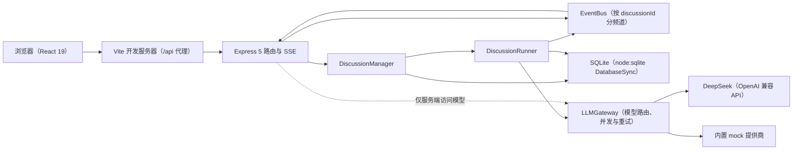
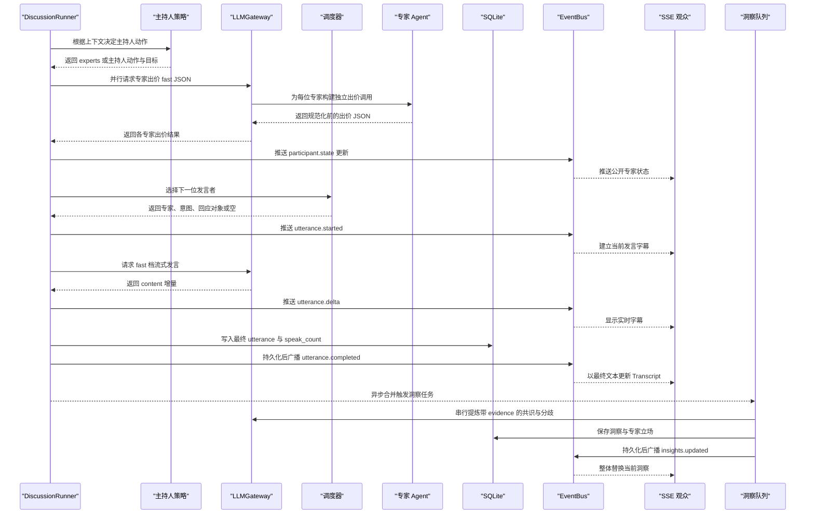
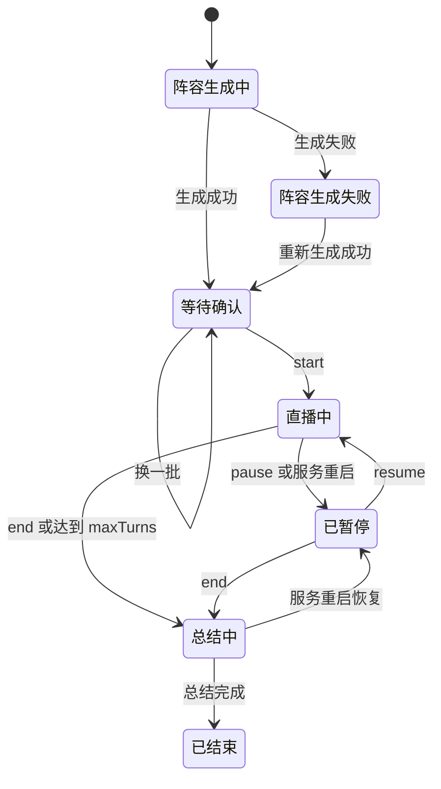
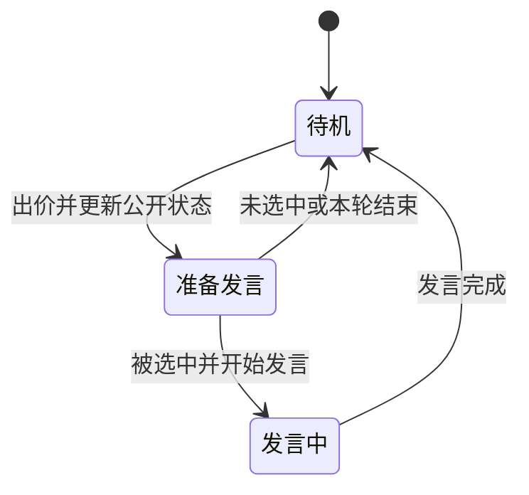

# 系统架构与设计规格

- **文档目的：** 固化系统分层、讨论引擎、核心纯函数、模型网关、安全边界与开发路线，为后续实现和测试提供唯一架构依据。
- **读者：** 前后端开发代理、测试代理、项目编排者。
- **版本：** v1.0
- **关联文档：** `docs/PRD.md`、`docs/ER.md`、`docs/API.md`、`docs/prompts/01-sdd-docs.md`

## 1. 系统总览



浏览器只访问同源 `/api`，由 Vite 在开发环境代理到后端；浏览器不直接调用模型。REST 路由处理快照与控制操作，SSE 路由按讨论订阅 `EventBus`。每个讨论由一个 `DiscussionRunner` 驱动，持久化状态和事件到 SQLite。`LLMGateway` 是后端访问 DeepSeek 或内置 `mock` 的唯一边界。

## 2. 目录与模块边界

| 路径/模块 | 职责与边界 |
|---|---|
| `shared/`（`@aps/shared`） | 前后端共享的领域 TypeScript 类型、zod schema、SSE 契约、常量与中文标签；是 API camelCase 契约的唯一类型来源。 |
| `server/src/config` | 读取并校验环境变量与默认配置；密钥只留在后端运行环境。 |
| `server/src/db` | SQLite `DatabaseSync` 连接、`schema.sql`、repository 与 snake_case/camelCase 映射；子表 repository 方法均以 `discussionId` 过滤。 |
| `server/src/llm` | `LLMGateway`、`LLMProvider`、DeepSeek 兼容实现、mock 提供商、并发限制、超时与重试。 |
| `server/src/prompts` | 任务指令模板；输入上下文由应用按讨论从数据库重建，不累积多轮模型消息。 |
| `server/src/core` | 与副作用隔离的纯函数：阵容、出价、发言调度、主持人策略、洞察合并、句子规则、上下文格式化、宽松 JSON 解析。 |
| `server/src/engine` | `DiscussionManager`、`DiscussionRunner`、`EventBus`；负责单场主循环、恢复、暂停、事件广播与隔离。 |
| `server/src/routes` | Express 健康检查、讨论 REST、SSE 路由与统一错误响应；状态转换按共享契约执行。 |
| `web/src/api` | `/api` JSON 与 SSE 客户端接入。 |
| `web/src/state` | 当前讨论、快照、实时事件与页面状态管理。 |
| `web/src/components` | 嘉宾卡片、专家状态小窗、Transcript、洞察等可复用视图。 |
| `web/src/pages` | 首页大厅、阵容确认、演播厅与回看页面。 |
| `e2e/` | Playwright 端到端测试（九类场景 + 默认跳过的真实模型场景）；根目录有 `playwright.config.ts` 与 `playwright.real-llm.config.ts`。 |

前端在浏览器中只持有 API 响应和公开讨论内容，不加载后端密钥，不访问模型服务地址。

## 3. 讨论引擎

### 3.1 运行主循环

```text
run():
  若该讨论还没有任何发言：speakHost('opening')
  while status == 'live' 且 turnCount < maxTurns:
    action = decideHostAction(ctx)
    if action 是 follow_up / bridge / invite：
      speakHost(action, target)
      addressed = target
    else：
      bids = 并行请求每位专家出价（fast 档，JSON）
      按抢答额度改写：额度用完或上一条正文就是 interrupt 时，interrupt 出价改为 rebut（§5.B）
      逐个更新专家 agentState/agentIntent/focus 并推送 participant.state
      if 全部出价请求都失败：
        记一次失败轮次（见 §8.2，连续 3 次转 paused）
        continue
      pick = selectNextSpeaker(bids, ctx, rng)
      if pick 为空：
        ctx.noBidders = true
        continue（下一轮由主持人点名）
      speakExpert(pick)   // 发言失败同样记失败轮次，成功则清零
      addressed = null
    turnCount += 1
    持久化并推送 discussion.status
    scheduleInsights()   // 串行队列、合并触发、不阻塞主循环
    sleep(PACING_MS)
    若被暂停则等待恢复或结束
  summarize()

speak(participant, act, replyTo):
  预留 seq 与 utteranceId
  participant → speaking
  推送 participant.state 与 utterance.started
  通过 fast 档流式请求
  句子限流器过滤模型增量并推送 utterance.delta，同时更新内存 liveUtterance
  final = clampSentences(sanitizeUtterance(全文), 对应上限)
  写入 utterances，speak_count + 1
  推送持久 utterance.completed
  participant → idle 并清空 intent
  推送 participant.state

summarize():
  status → summarizing（持久）
  等待洞察队列清空
  主持人 speaking
  通过 quality 档流式请求 3–4 段自然语言总结（输入本场全部发言，最多 40 条，见 §7.1）
  以 utterance.delta 推送总结流
  写入 act='closing' 的发言与 discussions.summary
  推送 utterance.completed、summary.completed
  status → ended，写 ended_at
  全部参与者回到 idle
```

每轮正文中，主持人 `follow_up`、`bridge`、`invite` 插话或一名专家发言都会计入 `turnCount`；开场 `opening` 与总结 `closing` 不计入。没有可发言专家时不产生发言，该轮不增加正文发言计数，并将 `noBidders` 留给下一轮主持人策略。

### 3.2 一轮发言时序



主持人动作直接发言时，发言内容同样经过流式限句、最终清洗、落库和持久事件广播。洞察队列串行运行、可合并触发，但不能阻塞下一轮主循环；洞察失败时记录日志，下一次触发连同遗漏发言一起处理。

### 3.3 发言句数上限

| 发言 | `act` | 句数上限 |
|---|---|---:|
| 主持人开场 | `opening` | 最多 3 句 |
| 主持人追问、串联、点名插话 | `follow_up`、`bridge`、`invite` | 每次最多 2 句 |
| 专家发言 | `statement`、`interrupt`、`supplement`、`rebut` | 每次最多 2 句 |
| 主持人总结 | `closing` | 不限句数 |

主持人点名后，被点名专家在下一轮出价中获得调度加成。

发言行为与出价意图的对应关系：

| 角色 | `SpeechAct` | 含义/对应意图 |
|---|---|---|
| 主持人 | `opening` | 开场。 |
| 主持人 | `follow_up` | 追问。 |
| 主持人 | `bridge` | 串联。 |
| 主持人 | `invite` | 点名邀请。 |
| 主持人 | `closing` | 总结。 |
| 专家 | `statement` | 陈述，来自 `raise_hand`。 |
| 专家 | `interrupt` | 抢答。 |
| 专家 | `supplement` | 补充。 |
| 专家 | `rebut` | 反驳。 |

## 4. 状态机

### 4.1 讨论状态



只允许图中列出的转换。其他状态转换返回 `409 INVALID_STATE`。服务启动时，数据库中遗留的 `live` 与 `summarizing` 讨论都转换为 `paused`；用户可继续或结束。

### 4.2 嘉宾 Agent 状态



`preparing` 状态可带 `agentIntent`：`raise_hand`、`interrupt`、`supplement` 或 `rebut`；其余状态 `agentIntent` 为 NULL。`focus` 是公开关注点，不是隐藏推理。

## 5. 核心纯函数规则（TDD 必测依据）

本节 A–H 规则是后续 TDD 的精确行为依据。下文列出的长度上限、枚举、权重与默认值不得由实现自行改变。

### A. 阵容规范化 `normalizeLineup(raw, expertCount)`

- **输入：** 模型 JSON `{ host: { name, profession, title, stance, stanceTag?, persona? }, experts: [同结构] }`。
- 所有字符串字段先修剪，再按以下上限截断（超长时保留前“上限 − 1”个字并以「…」结尾）：`name` 12 字、`profession` 20 字、`title` 30 字、`stance` 80 字、`stanceTag` 6 字、`persona` 200 字。
- 缺少 `stanceTag` 时填「观点」；缺少 `persona` 时填空串。
- `host` 缺失，或主持人/任一保留专家的必填字段 `name`、`profession`、`title`、`stance` 为空：抛 `LineupValidationError('INVALID_FORMAT')`。
- 专家多于 N 名时取前 N 名；少于 N 名时抛 `INSUFFICIENT_EXPERTS`。
- 姓名重复（含主持人与专家之间重复）时抛 `DUPLICATE_NAMES`。
- N ≥ 2 且所有专家的 `stanceTag` 相同时，抛 `LOW_DIVERSITY`。
- 抛错类型统一为 `LineupValidationError(code)`。
- 颜色由代码分配：主持人为 `#E8C872`；专家按 seat 依次使用 `EXPERT_PALETTE = ['#5B9DFF', '#FF6B9A', '#3DDC97', '#B18CFF', '#FF9F43', '#2ED3E6']`。
- `avatar` 为姓名第一个字符；seat 为主持人 0、专家 1..N。

### B. 出价规范化 `normalizeBid(raw, ctx)`

- **模型 JSON：**

```json
{
  "wantToSpeak": true,
  "intent": "rebut",
  "urgency": 0.8,
  "replyTo": "E2",
  "focus": "质疑 E2 的成本估算"
}
```

- `wantToSpeak` 非布尔值时变为 `false`。
- `intent` 不在 `raise_hand`、`interrupt`、`supplement`、`rebut` 中时变为 `raise_hand`。
- `urgency` 可为数字或数字字符串，钳制到 `[0,1]`；无法解析时为 `0.5`。
- `replyTo` 使用 `H` / `E1..En` 别名，映射为 participant ID；未知别名或指向本人时为 NULL。
- `focus` 修剪；超过 40 字时截断并以「…」结尾；空字符串变为 NULL。
- 输入不是对象时，精确返回 `{ wantToSpeak: false, intent: 'raise_hand', urgency: 0, replyToParticipantId: null, focus: null }`。
- 抢答额度（依赖讨论状态，由引擎在规范化之后、推送 `participant.state` 之前应用）：每场 `interrupt` 正文发言最多 `max(1, floor(maxTurns / 6))` 次（默认 16 轮为 2 次）。额度用完，或上一条正文发言的 act 就是 `interrupt` 时，本轮出价里的 `interrupt` 改为 `rebut`，其他字段不变，保证小窗意图与正文 act 一致。

### C. 调度打分 v1 `selectNextSpeaker(input)`

- **输入：** `bids`（每位专家规范化后的出价）、`lastSpeakerId`（上一条发言人，可能是主持人）、`recentExpertSpeakerIds`（最近 2 条专家发言的发言人）、`recentExpertActs`（最近 `ACT_VARIETY_WINDOW` = 3 条专家正文发言的 act，按时间正序，不含主持人发言、开场与总结；可省略，省略时视为空）、`lastSpokeTurn`（专家 ID → 最近一次发言所在的 turn 序号，未发言则无）、`turnIndex`、`addressedParticipantId`（主持人刚点名的专家，可空）、`rng`（返回 `[0,1)` 的函数，可注入以便测试）。
- 被点名专家若没有出价或 `wantToSpeak=false`，视为一条 `raise_hand`、`urgency=0.5` 的出价。
- 候选必须 `wantToSpeak=true`，并且不是 `lastSpeakerId`；上一条若是主持人则不排除任何专家。无候选返回 `null`。
- 对每位候选使用以下分数相加：

| 加减项 | 条件 | 分数 |
|---|---|---:|
| `urgency` | 出价紧急度 | 出价的 0–1 数值 |
| 意图权重 | `rebut` / `interrupt` / `supplement` / `raise_hand` | `+0.30` / `+0.25` / `+0.15` / `+0.10` |
| 直接回应 | `replyToParticipantId` 指向上一位发言人 | `+0.20` |
| 抢答加成 | `intent=interrupt` 且 `urgency ≥ 0.8` | `+0.30` |
| 最近发言惩罚 | 专家 ID 在 `recentExpertSpeakerIds` 中 | `−0.25` |
| 公平加成 | 从未发言或距上次发言 ≥ 4 轮（由 `turnIndex` 与 `lastSpokeTurn` 判断） | `+0.15` |
| 行为多样性加成 | 出价对应的发言行为（`raise_hand` 记为 `statement`）不在 `recentExpertActs` 中；`recentExpertActs` 为空时不加 | `+0.25` |
| 被点名加成 | 专家 ID 等于 `addressedParticipantId` | `+0.60` |
| 随机扰动 | 用注入的 `rng()` | `+rng() × 0.05` |

- 返回得分最高者 `{ participantId, intent, replyToParticipantId, score }`。
- 总分相同（包括加入 `rng` 扰动后仍相同）时，依次比较：`urgency` 较高者优先，再由 `seat` 较小者优先。
- 所有权重以常量 `SCHEDULER_WEIGHTS` 导出，多样性窗口大小以常量 `ACT_VARIETY_WINDOW` 导出，两者都在 `server/src/core/scheduler.ts`。
- 设计意图：由“谁更想说、说什么”决定发言顺序，而非按座位轮流；硬规则保证同一专家不会连续两次发言。行为多样性加成只在最近几条专家正文都没有出现某种发言行为时起作用，让一直在反驳时的补充（或一直在补充时的反驳）有机会胜出，避免整场只有一种交锋方式。

### D. 主持人策略 `decideHostAction(ctx)`

上下文中的 `expertTurnsSinceHost` 表示最近一次主持人发言之后的专家发言条数；最近一次主持人发言包括 `opening`。每次主持人发言完成后，将 `expertTurnsSinceHost` 复位为 0，并将 `noBidders` 复位为 `false`。被点名专家完成发言后，将 `addressed` 清空。

按顺序匹配，命中即返回：

0. 上一轮无人出价（`noBidders`）：返回 `invite`，目标是 `speakCount` 最少的专家，并列取 seat 最小者。即使上一条发言来自主持人（例如开场后首轮无人出价）也优先适用：点名本身是一条正文发言，且被点名者在下一轮出价中必然成为候选，从而保证主循环总能推进。
1. 上一条发言来自主持人：`{ action: 'experts' }`。
2. `expertTurnsSinceHost ≥ HOST_INTERVAL`（3）：
   - 最近一次 bridge / follow_up 插话是 `bridge`，且上一条正文来自专家：返回 `follow_up`，目标为上一位专家发言人。
   - 否则，存在 active 分歧且其 `stances` 含 ≥ 2 名专家：先取 `updatedAtSeq` 最大的那条分歧，返回 `bridge`，再选取该分歧中不是上一位发言人且 `speakCount` 最少的专家，并列取 seat 最小者。
   - 否则返回 `follow_up`，目标为上一位专家发言人。
3. 存在 `speakCount = 0` 的专家且 `turnCount ≥ expertCount + 1`：返回 `invite` 该专家；多人未发言时取 seat 最小者。
4. 以上均不满足：返回 `{ action: 'experts' }`。

### E. 洞察合并 `mergeInsights(current, patch, ctx)`

- **模型增量 JSON：**

```json
{
  "consensus": [
    {
      "ref": "C1",
      "content": "可以从低风险场景开始试点",
      "participants": ["E1", "E3"],
      "evidence": [3, 5]
    }
  ],
  "divergences": [
    {
      "ref": "D1",
      "content": "自动化效率是否值得承担信任风险",
      "stances": [
        { "who": "E1", "position": "效率收益值得逐步验证" },
        { "who": "E3", "position": "复杂问题应优先保障信任" }
      ],
      "evidence": [4, 6],
      "resolved": false
    }
  ]
}
```

- **上下文 `ctx`：** `discussionId`、`aliasToParticipantId`（仅专家别名）、`refToInsightId`（`C1..`/`D1..` 到已有洞察 ID）、`validSeqs`、`currentSeq`、`now`、`newId()`、`maxPerKind`（6）、`similarityThreshold`（0.6）。
- ① `content` 修剪；超过 80 字时截断并以「…」结尾；空内容丢弃。
- ② 别名映射到专家 ID；未知别名和主持人 `H` 丢弃。共识去重后少于 2 名专家、分歧少于 2 名专家时丢弃。立场 `position` 超过 40 字时截断并以「…」结尾；共识缺少立场时记为「认同」。
- ③ `evidence` 只保留 `validSeqs` 中的发言序号，去重并升序；结果为空则丢弃（无证据不入库）。
- ④ `ref` 命中同类已有条目时更新：`content` 覆盖、`stances` 按 `participantId` 合并（新值覆盖旧值，旧值保留）、`evidence` 合并去重、`updatedAtSeq = currentSeq`、`updatedAt = now`。分歧 `resolved=true` 时将 `status` 设为 `resolved`。
- ⑤ 无 `ref` 或 `ref` 未命中时，与同类已有条目计算相似度：去掉标点与空白后的字符二元组 Jaccard。相似度 ≥ 阈值则按④更新该条，否则新建，状态为 `active`。
- ⑥ 补丁未提及的已有条目原样保留。
- ⑦ 每类条目超过 `maxPerKind` 时，按 `updatedAtSeq` 降序保留前 `maxPerKind` 条。
- ⑧ 返回 `{ insights, changed }`，其中 `changed: boolean`。当且仅当本次合并新增、修改或淘汰了任意条目时为 `true`；补丁为空或所有补丁条目都被丢弃时为 `false`。

### F. 句子规则

#### `sanitizeUtterance(text, speakerName)`

- 去掉开头精确匹配的发言人前缀：`{speakerName}：`、`{speakerName}:`、`【{speakerName}】`、`**{speakerName}**：` 或 `主持人：`。
- 若整体被引号（`“”`、`"`、`「」`）包裹，去掉包裹引号。
- 去掉 Markdown 符号：`**`、`__`、反引号、行首 `#` 和 `-`。
- 合并换行与多余空白并修剪。

#### `clampSentences(text, max)`

- 句末标记为 `。！？!?` 和省略号（`…` / `……`）。
- 英文句点只有在其后是空白或文本结尾、且前一字符不是数字时才算句末，避免把 `3.5` 拆开。
- 紧跟句末的右引号/右括号（`” ’ " ' 」 』 ） ) 】`）归入该句。
- 保留前 `max` 句。
- 没有任何句末标记且文本超过 120 字时，截取前 120 字并加「…」。

#### `createSentenceLimiter(max, speakerName)`

- 是流式过滤器；`push(delta)` 返回本次可推送给前端的文本，`done` 表示已达到上限。
- 开头先缓冲，直到出现 `：`、`:`、`】` 或累计 16 个字符，以便去掉发言人前缀。
- 达到上限后不再输出。
- 前端收到 `utterance.completed` 后以最终文本替换流式文本。

### G. 上下文构建

- `buildAliasMap(participants)`：主持人映射为 `H`，专家按 seat 升序映射为 `E1..En`。
- `buildTranscriptWindow(utterances, participants, k = 10)`：取最近 k 条发言，按时间正序；每行格式为 `#{seq} {别名} {姓名}（{title}）：{content}`。
- `formatInsightsForPrompt(insights, participants)`：共识按创建顺序编号 `C1..`，分歧按创建顺序编号 `D1..`；分歧列出各专家立场，已化解的分歧加注「（已化解）」。

### H. JSON 解析 `parseJsonLoose(text)`

修剪输入；去掉三反引号与 `json` 标记组成的围栏；若直接 JSON 解析失败，截取第一个 `{` 到最后一个 `}` 再解析；仍失败时抛 `LLMFormatError`。

### 5.1 固定常量与权重表

| 常量 | 值 |
|---|---|
| `HOST_INTERVAL` | `3` |
| `TRANSCRIPT_WINDOW` | `10` |
| `MAX_INSIGHTS_PER_KIND` | `6` |
| `FOCUS_MAX` | `40` |
| `SIMILARITY_THRESHOLD` | `0.6` |
| `EXPERT_COUNT` | `{ min: 2, max: 6, default: 4 }` |
| `TOPIC_LENGTH` | `{ min: 2, max: 200 }` |
| `EXPERT_PALETTE` | `['#5B9DFF', '#FF6B9A', '#3DDC97', '#B18CFF', '#FF9F43', '#2ED3E6']` |
| 主持人颜色 | `#E8C872` |

`SCHEDULER_WEIGHTS` 的含义和值由 C 节权重表固定：`rebut 0.30`、`interrupt 0.25`、`supplement 0.15`、`raise_hand 0.10`、直接回应 `0.20`、抢答加成 `0.30`、最近发言惩罚 `0.25`、公平加成 `0.15`、行为多样性加成 `0.25`、被点名加成 `0.60`、随机扰动系数 `0.05`；行为多样性窗口 `ACT_VARIETY_WINDOW` 为 `3`。

## 6. 技术栈、LLM 网关与模型路由

### 6.1 工程技术栈

| 层 | 规格 |
|---|---|
| Monorepo | npm workspaces 目前只有 `shared/`（`@aps/shared`）、`server/`（`@aps/server`）、`web/`（`@aps/web`）。 |
| 后端 | Node.js ≥ 22.13、TypeScript、Express 5、zod、`node:sqlite` 的 `DatabaseSync`、SSE。默认端口 `8787`。 |
| 前端 | React 19、Vite、TypeScript、Tailwind CSS v4、React Router 7、lucide-react。开发端口 `5173`；`/api` 代理到后端，同源访问无需 CORS。 |
| 测试 | Vitest（单元/集成）、supertest；Playwright（`channel: 'msedge'`）E2E：根 `playwright.config.ts` 以 desktop / fhd / ultrawide / mobile 四个 project 运行 `e2e/`，默认 mock 不依赖网络；真实模型场景由 `playwright.real-llm.config.ts` 单独驱动（`npm run test:e2e:real`）。 |
| 持久化 | SQLite；数据库列 `snake_case`，API 与共享契约 `camelCase`。 |

### 6.2 网关契约与路由

```ts
type LLMTask =
  | 'lineup'
  | 'bid'
  | 'utterance'
  | 'host'
  | 'insights'
  | 'summary';
type LLMTier = 'quality' | 'fast';
type LLMThinking = 'disabled' | 'low' | 'high';

interface LLMRequest {
  task: LLMTask;
  system: string;
  user: string;
  json?: boolean;
  temperature?: number;
  maxTokens?: number;
  thinking?: LLMThinking; // 省略时使用提供商默认值
  context?: unknown; // 仅 mock 使用的结构化上下文
  signal?: AbortSignal;
  discussionId?: string;
}

interface LLMProvider {
  name: 'deepseek' | 'mock';
  complete(
    req: LLMRequest & { model: string }
  ): Promise<{
    text: string;
    usage?: { promptTokens: number; completionTokens: number };
  }>;
  stream(
    req: LLMRequest & { model: string }
  ): AsyncIterable<string>; // 只产出 content 增量
}
```

| 任务 | 档位 | 默认模型 | 思考模式 | `temperature` | `maxTokens` | 说明 |
|---|---|---|---|---:|---:|---|
| `lineup` | `quality` | `deepseek-v4-pro` | `disabled` | 0.9 | 3000 | 阵容生成，JSON。 |
| `summary` | `quality` | `deepseek-v4-pro` | `disabled` | 0.5 | 1500 | 主持人总结，流式自然语言。 |
| `bid` | `fast` | `deepseek-flash` | `disabled` | 0.7 | 300 | 专家出价，JSON。 |
| `utterance` | `fast` | `deepseek-flash` | `disabled` | 0.8 | 300 | 专家发言，流式。 |
| `host` | `fast` | `deepseek-flash` | `disabled` | 0.7 | 300 | 主持人开场、追问、串联、点名，流式。 |
| `insights` | `fast` | `deepseek-flash` | `disabled` | 0.2 | 1500 | 共识/分歧提炼，JSON。 |

思考模式映射（以 DeepSeek Chat Completions 文档为准）：`disabled` → 请求体发送 `"thinking": {"type": "disabled"}` 与 `temperature`；`low` / `high` → 发送 `"thinking": {"type": "enabled"}` 与 `"reasoning_effort": "low" | "high"`，此时不发送 `temperature`（思考模式下无效），`maxTokens` 必须同时容纳思考内容与回答。`maxTokens` 统一映射为请求体的 `max_tokens`。

- 提供商选择：显式设置 `LLM_PROVIDER` 时优先使用；否则有 `LLM_API_KEY` 就使用 `deepseek`，没有则使用 `mock` 并在启动日志提示。
- DeepSeek 使用 OpenAI 兼容 Chat Completions：`POST {LLM_BASE_URL}/chat/completions`，Authorization 为 Bearer Key。JSON 任务设置 `response_format: {"type":"json_object"}`。
- 可用模型为 `deepseek-v4-pro`（质量档）与 `deepseek-flash`（速度档）。两者默认开启思考模式并返回 `reasoning_content`。本应用所有任务默认关闭思考模式：首字延迟更低、`temperature` 生效，并且从源头上不产生隐藏思维链；专家小窗的“关注点”只来自出价任务的公开 `focus` 字段。网关仍须防御性地丢弃任何 `reasoning_content`。
- 流式解析 `data:` 行、忽略 `[DONE]`，只取 `choices[0].delta.content`。`reasoning_content` 一律丢弃，不进入应用上下文。
- 超时：quality 90 秒、fast 30 秒。网络错误、429、5xx 重试 1 次，退避 800ms。全局并发上限由 `LLM_MAX_CONCURRENCY` 控制。
- 日志只记录 task、model、耗时与 token 用量，不记录 Key 和推理内容。

### 6.3 Mock 提供商

- 按 `discussionId + task + 调用序号` 确定性生成中文内容，以支持可重复测试和无 Key 演示。
- 使用 `context` 中的结构化讨论数据保持内容连贯；例如反驳需点名真实被反驳者，洞察中的分歧来自真实反驳关系。
- JSON 任务输出 JSON 字符串，并经过与真实提供商相同的解析和校验路径。
- `stream` 把文本切成 2–4 字分片，分片间隔由 `MOCK_STREAM_DELAY_MS` 控制；每次调用延迟由 `MOCK_LATENCY_MS` 控制。

## 7. 运行时 Prompt、上下文结构与防幻觉

### 7.1 上下文构建原则

- 每次 LLM 调用无状态，不累积多轮 messages。代码从数据库重建精简上下文：角色卡、话题、阵容名册（别名、姓名、身份与立场标签，例如 `E2 陈澄｜用户研究负责人｜立场：审慎`）、当前共识/分歧、最近 10 条发言和本次任务指令。出价任务还由代码给出上一条发言人及其立场、与本人立场的方向关系（同向、相反、一方中立或谨慎、方向不明），以及本场抢答已用次数和本轮能否抢答；洞察任务同时提供最近发言窗口，evidence 可以引用其中任意真实 seq（以 §5.E ③ 的 `validSeqs` 为准）。总结任务例外：提供本场全部发言（最多 40 条；超出时保留开场与最近 39 条），以便完整回顾讨论走向。
- 除总结任务（最多 40 条发言）外，上下文长度与讨论总长度无关；不同讨论不会共享对话上下文。
- 使用 `H`、`E1..En`、`C1..`、`D1..` 代替 UUID。模型不接触内部 ID，别名到数据库 ID 的映射与校验由代码负责。
- JSON 任务启用 `json_object` 模式并做 zod 校验；失败重试 1 次，再按任务规定采用兜底行为（例如出价规范化的默认值、阵容最终失败返回 `502 LLM_ERROR`：创建或从 `failed` 重新生成时讨论为 `failed`，从 `lineup_ready` 换一批时保留原阵容与状态，洞察失败留待下次触发）。
- 发言使用中文、1–2 句、不加姓名前缀、不用 Markdown、不写动作描写；只回应 transcript 中真实出现的观点。引用数据需加「据我了解/大致」等限定，不得编造具体报告或机构名称。
- 共识/分歧必须包含发言 `seq` evidence，后端验证序号存在；无证据不入库。
- 专家小窗关注点来自独立出价任务的 `focus` 字段，不得使用 `reasoning_content`。
- 总结是 3–4 段自然语言，不得输出 JSON、代码块或表格。若以 `{` 或 `[` 开头，或能够被 `JSON.parse` 解析，则视为失败并重试或兜底。

下列 JSON 展示供 prompt builder 使用的精简上下文示意，不是新增 REST 字段，也不允许含真实内部 UUID：

```json
{
  "topic": "AI 助手是否适合进入企业客服",
  "roleCard": {
    "name": "周明",
    "profession": "服务设计师",
    "title": "服务设计顾问",
    "stance": "支持从低风险、重复性高的场景试点",
    "stanceTag": "谨慎乐观",
    "persona": "重视流程设计与用户体验"
  },
  "aliasMap": {
    "H": "林知远",
    "E1": "周明",
    "E2": "陈澄"
  },
  "insights": {
    "consensus": ["C1 先从低风险场景试点"],
    "divergences": ["D1 自动化效率与信任风险"]
  },
  "transcriptWindow": [
    "#3 E2 陈澄（用户研究负责人）：复杂问题仍需要明确的人工升级路径。"
  ],
  "instruction": "仅依据以上讨论上下文完成当前任务。"
}
```

### 7.2 任务输入与输出结构示例

以下示例分别展示任务专属输入与输出。运行时按任务适用范围，从话题、角色卡、别名、洞察、最近 10 条发言（总结任务为本场全部发言，最多 40 条）和本次任务指令构造上下文；阵容任务使用话题、专家人数和生成指令。流式文本任务不得改成 JSON 输出。

#### 阵容 `lineup`

输入：

```json
{
  "topic": "AI 助手是否适合进入企业客服",
  "expertCount": 2,
  "instruction": "生成一位主持人和两位立场多样的专家，按约定字段返回 JSON。"
}
```

JSON 输出结构：

```json
{
  "host": {
    "name": "林知远",
    "profession": "访谈主持",
    "title": "圆桌主持人",
    "stance": "保持开放，帮助各方把观点说清楚。",
    "stanceTag": "引导",
    "persona": "善于倾听并串联观点。"
  },
  "experts": [
    {
      "name": "周明",
      "profession": "服务设计师",
      "title": "服务设计顾问",
      "stance": "支持从低风险场景开始试点。",
      "stanceTag": "谨慎乐观",
      "persona": "重视流程设计与用户体验。"
    },
    {
      "name": "陈澄",
      "profession": "消费者研究员",
      "title": "用户研究负责人",
      "stance": "担心复杂问题中的信任下降。",
      "stanceTag": "审慎",
      "persona": "关注服务质量与用户权益。"
    }
  ]
}
```

此处为与输入人数一致的输出示例；生产请求中的 `expertCount` 可能为 2–6，必须返回对应人数并通过 `normalizeLineup` 校验。

#### 专家出价 `bid`

输入：

```json
{
  "topic": "AI 助手是否适合进入企业客服",
  "speakerAlias": "E1",
  "aliasMap": {
    "H": "林知远",
    "E1": "周明",
    "E2": "陈澄"
  },
  "recentTranscript": [
    "#4 E2 陈澄（用户研究负责人）：复杂问题仍需要明确的人工升级路径。"
  ],
  "instruction": "根据真实 transcript 返回本轮是否发言、意图、紧急度、回应别名和公开关注点。"
}
```

JSON 输出：

```json
{
  "wantToSpeak": true,
  "intent": "rebut",
  "urgency": 0.8,
  "replyTo": "E2",
  "focus": "回应复杂问题的人工升级路径"
}
```

#### 专家发言 `utterance`

输入：

```json
{
  "topic": "AI 助手是否适合进入企业客服",
  "speakerAlias": "E1",
  "act": "rebut",
  "replyToAlias": "E2",
  "recentTranscript": [
    "#4 E2 陈澄（用户研究负责人）：复杂问题仍需要明确的人工升级路径。"
  ],
  "instruction": "用中文写 1–2 句，只回应已有观点，不加姓名前缀或 Markdown。"
}
```

输出为流式自然语言文本，而非 JSON，例如：

```text
我同意复杂问题需要升级路径，但这并不妨碍先在规则清晰的场景验证效果。
```

#### 主持人 `host`

输入：

```json
{
  "topic": "AI 助手是否适合进入企业客服",
  "hostRoleCard": {
    "name": "林知远",
    "stance": "保持开放，帮助各方把观点说清楚。"
  },
  "action": "follow_up",
  "targetAlias": "E2",
  "recentTranscript": [
    "#4 E2 陈澄（用户研究负责人）：复杂问题仍需要明确的人工升级路径。"
  ],
  "instruction": "以主持人语气用中文追问，最多两句，不加姓名前缀或 Markdown。"
}
```

输出为流式自然语言文本，例如：

```text
陈澄提到复杂问题的升级路径。你认为哪些情况应当优先转交人工？
```

#### 洞察 `insights`

输入：

```json
{
  "topic": "AI 助手是否适合进入企业客服",
  "aliasMap": {
    "E1": "周明",
    "E2": "陈澄"
  },
  "existingInsightRefs": {
    "C1": "已有共识",
    "D1": "已有分歧"
  },
  "newUtterances": [
    {
      "seq": 3,
      "speakerAlias": "E1",
      "content": "可以先从规则清晰的客服场景开始试点。"
    },
    {
      "seq": 4,
      "speakerAlias": "E2",
      "content": "复杂问题仍需要明确的人工升级路径。"
    }
  ],
  "instruction": "仅返回新增或变化的、有真实发言 seq 证据的共识和分歧 JSON。"
}
```

JSON 输出：

```json
{
  "consensus": [
    {
      "ref": null,
      "content": "试点应设置明确的问题范围。",
      "participants": ["E1", "E2"],
      "evidence": [3, 4]
    }
  ],
  "divergences": [
    {
      "ref": "D1",
      "content": "自动化效率是否值得承担信任风险。",
      "stances": [
        {
          "who": "E1",
          "position": "效率收益值得逐步验证"
        },
        {
          "who": "E2",
          "position": "复杂问题应优先保障信任"
        }
      ],
      "evidence": [3, 4],
      "resolved": false
    }
  ]
}
```

#### 总结 `summary`

输入：

```json
{
  "topic": "AI 助手是否适合进入企业客服",
  "insights": {
    "consensus": ["先限定问题范围并逐步试点。"],
    "divergences": ["效率收益与复杂问题中的用户信任仍需权衡。"]
  },
  "transcript": [
    "#1 H 林知远（主持人）：欢迎来到圆桌……",
    "#4 E2 陈澄（用户研究负责人）：复杂问题仍需要明确的人工升级路径。"
  ],
  "instruction": "用主持人自然语言写 3–4 段，不输出 JSON、代码块或表格。"
}
```

`transcript` 是本场全部发言（最多 40 条；超出时保留开场与最近 39 条）。输出为流式自然语言 3–4 段，例如：

```text
本场讨论认为，客服自动化可以从问题范围明确、风险较低的场景开始验证。

专家对复杂问题中的信任保障和人工升级方式仍有不同侧重。

后续试点应同步评估服务效率、误答处理与用户申诉路径。
```

## 8. 并行隔离、容错与恢复

### 8.1 多讨论并行隔离

- `DiscussionManager` 以 `Map<discussionId, DiscussionRunner>` 管理每个讨论的独立 Runner。
- 每个 Runner 的 RNG、调用计数器、洞察队列、暂停信号与 `AbortController` 均为实例字段，不使用模块级可变状态。
- `EventBus` 按 `discussionId` 分频道；SSE 仅订阅 URL 中指定的讨论。
- 所有涉及子表的 repository 函数都接收 `discussionId`，并在 SQL 中按其过滤。
- `events.seq` 和 `utterances.seq` 均按讨论独立递增。
- LLM 最大并发数是唯一全局共享的运行资源；每次 LLM 请求上下文只来自当前讨论。
- 删除讨论时，管理器停止该 Runner，EventBus 结束相关 SSE 流，再级联删除 SQLite 关联数据。

### 8.2 失败处理

| 环节 | 规定行为 |
|---|---|
| 专家出价 | 返回内容无法解析为 JSON（`LLMFormatError`）时，立即用同一 Prompt 重试 1 次：DeepSeek 的 JSON 模式在模型输出不是合法 JSON 时会把内容替换为空格，返回看起来是空内容，官方建议代码重试。请求错误（网络、429、5xx、超时）只按网关规则重试，Runner 不再额外重试；能解析但字段无效时按 §5.B 的默认值处理。重试后仍无法解析或请求最终出错时，视为该专家本轮不发言，不中止其他专家出价或主循环。若一轮中全部专家的出价请求都失败（请求错误或重试后仍无法解析，而不是不想发言），该轮计为一次失败轮次，不置 `noBidders`。 |
| 发言生成 | 失败重试 1 次；仍失败则推送瞬时 `error`（「某嘉宾暂时掉线，讨论继续」）、跳过本轮且不计 `turnCount`。 |
| 连续发言失败 | 发言失败轮次与“全部出价失败”轮次共用一个连续失败计数，任一条发言成功即清零。连续 3 轮失败后状态转为 `paused`，`error_message` 写「大模型服务暂时不可用，讨论已暂停，可稍后继续」。 |
| 洞察提炼 | 失败记日志；下次触发时把遗漏的发言一并处理，不阻塞主循环。 |
| 主持人总结 | 失败重试 1 次；仍失败时根据当前共识/分歧用代码模板生成自然语言兜底总结。 |
| 阵容生成 | JSON 解析或校验失败时将错误原因反馈给模型再试 1 次；最终失败时，创建讨论或从 `failed` 重新生成会保持/进入 `failed`，从 `lineup_ready` 换一批则保留原阵容与状态、不追加事件；两种情况均返回 `502 LLM_ERROR`。 |
| 模型服务请求 | 网络错误、429、5xx 按 LLM 网关规则重试 1 次，退避 800ms；quality 90 秒、fast 30 秒超时。 |

### 8.3 暂停与启动恢复

- 用户请求暂停后，正在生成的当前发言完成，再停住；已暂停可继续或结束。
- 服务启动恢复时，所有遗留 `live` 和 `summarizing` 状态都转为 `paused`，避免服务重启后出现未受 Runner 管理的活动状态。
- 持久事件可通过数据库按序补发；瞬时流式片段不入库，恢复快照以已完成的数据库状态为准。
- 总结开始前等待该讨论洞察队列清空；总结完成后写 `ended_at`，并将所有参与者状态置为 `idle`。

SSE 新连接的补发与实时订阅必须无缝衔接：服务端先订阅该讨论的 `EventBus` 并将实时事件放入连接缓冲区，再按游标查询 `events` 表中 `seq` 更大的持久事件并按序发送。以游标作为已覆盖水位；发送期间记录最大已发送序号。随后按到达顺序冲刷缓冲区，持久事件若 `seq` 不大于最大已发送序号则跳过，其余事件（包括瞬时事件）发送；缓冲区冲刷完后切换为直接推送。客户端 reducer 按 `seq` 去重持久事件。

## 9. 安全边界与配置项

### 9.1 安全设计

- API Key 只放在后端环境变量（`server/.env`，由 Git 忽略），健康检查只返回提供商名和模型名；日志不得打印 Key，前端不得直接调用模型。
- 模型返回的 `reasoning_content` 必须丢弃，不得转发、存储、记录或展示。
- 所有请求体使用 zod 校验；SQL 使用预编译语句和参数绑定。
- DeepSeek 只由服务端 `LLMGateway` 访问；浏览器不接收 Key，也不应连接模型 URL。
- 错误响应只包含中文可展示消息和受控 details，不返回堆栈。

### 9.2 后端配置（`server/.env`，模板 `server/.env.example`）

| 变量 | 默认值 | 说明 |
|---|---|---|
| `PORT` | `8787` | 后端端口。 |
| `DATABASE_PATH` | `./data/panel.db` | SQLite 文件，相对 `server/`；测试可设为 `:memory:`。 |
| `LLM_PROVIDER` | 空（自动） | `deepseek` / `mock`；显式值优先。 |
| `LLM_API_KEY` | 空 | DeepSeek API Key，仅后端读取。 |
| `LLM_BASE_URL` | `https://api.deepseek.com` | OpenAI 兼容地址。 |
| `LLM_MODEL_QUALITY` | `deepseek-v4-pro` | 质量档模型。 |
| `LLM_MODEL_FAST` | `deepseek-flash` | 速度档模型。 |
| `LLM_MAX_CONCURRENCY` | `6` | 全局并发上限。 |
| `MAX_TURNS` | `16` | 每场正文发言上限。 |
| `PACING_MS` | `800` | 两条发言之间的节奏间隔。 |
| `MOCK_LATENCY_MS` | `400` | mock 每次调用的模拟延迟。 |
| `MOCK_STREAM_DELAY_MS` | `30` | mock 流式分片间隔。 |

### 9.3 前端配置（Vite）

| 变量 | 默认值 | 说明 |
|---|---|---|
| `WEB_PORT` | `5173` | 前端开发端口。 |
| `API_PROXY_TARGET` | `http://localhost:8787` | Vite `/api` 代理目标。 |

## 10. 开发范式路线图

| 阶段 | 输入 | 执行方式 | 产出与验收方向 |
|---|---|---|---|
| **SDD（本阶段）** | 产品需求原文、第 2 节已定技术与业务决策、项目 `AGENTS.md`。 | 将定位、数据、API、状态机、算法和边界固化为相互一致的规格；不写业务代码。 | `docs/PRD.md`、`docs/ER.md`、`docs/API.md`、`docs/ARCHITECTURE.md`；四份文档成为后续实现唯一规格依据。 |
| **DDD（设计驱动前端组件与页面）** | PRD 的用户流程、功能和响应式要求；API 契约、领域类型；项目视觉/交互约定（如已提供）。 | 在实现页面前划分首页、阵容确认、演播厅、回看页面及专家卡片、状态小窗、Transcript、洞察等组件边界，并验证跨屏布局和交互。 | 前端页面/组件设计及对应实现；不得另造状态、字段或事件，必须符合 SDD 契约。 |
| **TDD（核心逻辑先测后写）** | ARCHITECTURE 第 5 节 A–H 规则、共享 schema、数据与 API 契约。 | 先逐条编写纯函数测试，再实现阵容规范化、出价、调度、主持人策略、洞察合并、句子规则、上下文构建和 JSON 解析。 | 覆盖边界值、异常输入、权重与状态的单元测试及实现；纯规则变更需同步更新规格并由编排者确认。 |
| **E2E（系统级端到端与质量闭环）** | PRD 核心流程、API/SSE 契约、前端页面和引擎实现、确定性 mock。 | 用 Playwright 从创建讨论、确认阵容、开播、观察实时事件、暂停/继续、结束到回看验证真实系统边界。 | 可重复的端到端质量闭环；E2E 使用 mock，验证响应式布局、并行讨论隔离、SSE 增量/补发和用户可见错误。 |
