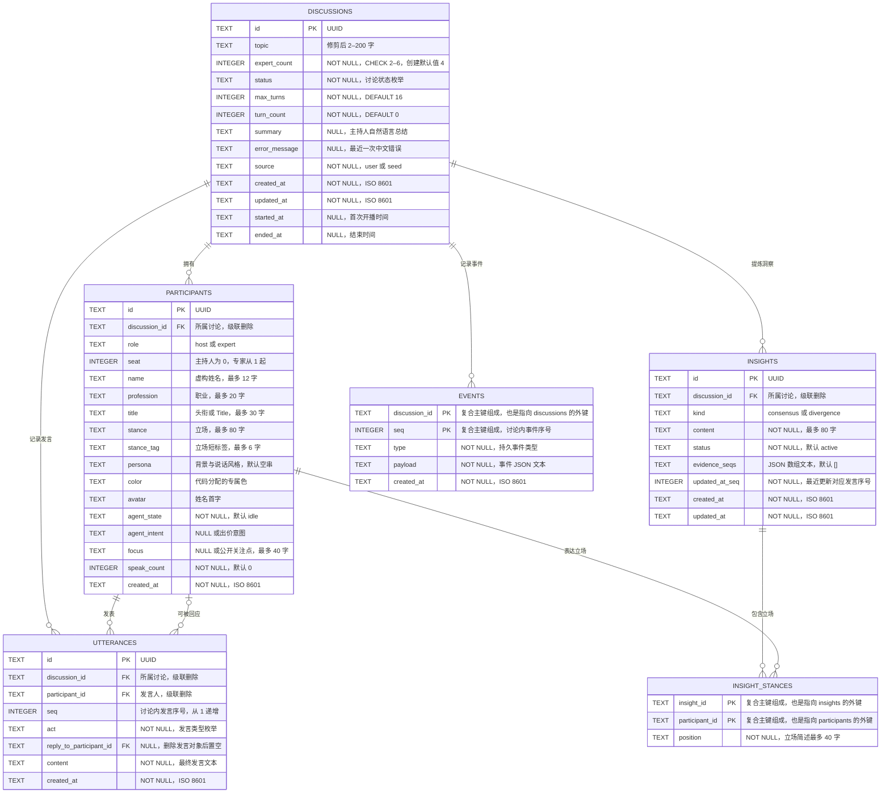

# 数据模型与 ER 图

- **文档目的：** 定义 SQLite 持久化模型、字段约束、表关系和典型读取方式。
- **读者：** 后端开发代理、前端契约开发代理、测试代理。
- **版本：** v1.0
- **关联文档：** `docs/PRD.md`、`docs/API.md`、`docs/ARCHITECTURE.md`、`docs/prompts/01-sdd-docs.md`

## 1. ER 图



`insight_stances` 的复合主键为 `(insight_id, participant_id)`，两个字段同时分别外键引用 `insights.id`、`participants.id`。`events` 的复合主键为 `(discussion_id, seq)`，其中 `discussion_id` 同时外键引用 `discussions.id`。`participants` 的额外唯一约束为 `(discussion_id, seat)`；`utterances` 的额外唯一约束为 `(discussion_id, seq)`。上述唯一约束不改变图中字段与引用关系。

## 2. 数据字典

所有 `id` 均为 UUID 字符串；所有时间均以 ISO 8601 字符串保存。数据库列统一使用 `snake_case`。SQLite 中无独立 JSON 列类型，JSON 内容以 `TEXT` 保存。

### 2.1 `discussions`（讨论）

| 列 | 类型 | 约束 | 说明 |
|---|---|---|---|
| `id` | TEXT | PK | UUID。 |
| `topic` | TEXT | NOT NULL | 修剪后 2–200 字的话题。 |
| `expert_count` | INTEGER | NOT NULL，CHECK 2–6 | 专家人数，不含主持人；创建默认 4。 |
| `status` | TEXT | NOT NULL，CHECK 枚举 | 讨论状态，见枚举说明。 |
| `max_turns` | INTEGER | NOT NULL，DEFAULT 16 | 正文发言上限，不含开场和总结。 |
| `turn_count` | INTEGER | NOT NULL，DEFAULT 0 | 已完成正文发言数，含主持人插话。 |
| `summary` | TEXT | NULL | 主持人自然语言总结。 |
| `error_message` | TEXT | NULL | 最近一次可展示的中文错误。 |
| `source` | TEXT | NOT NULL，DEFAULT `'user'`，CHECK `user`/`seed` | 数据来源。 |
| `created_at` | TEXT | NOT NULL | 创建时间。 |
| `updated_at` | TEXT | NOT NULL | 最近更新时间。 |
| `started_at` | TEXT | NULL | 首次开播时间。 |
| `ended_at` | TEXT | NULL | 结束时间。 |

### 2.2 `participants`（主持人与专家）

| 列 | 类型 | 约束 | 说明 |
|---|---|---|---|
| `id` | TEXT | PK | UUID。 |
| `discussion_id` | TEXT | NOT NULL，FK→`discussions.id`，ON DELETE CASCADE | 该嘉宾所属讨论。 |
| `role` | TEXT | NOT NULL，CHECK `host`/`expert` | 主持人或专家。 |
| `seat` | INTEGER | NOT NULL，UNIQUE(`discussion_id`, `seat`) | 主持人 0，专家为 1..N。 |
| `name` | TEXT | NOT NULL | 虚构姓名，最多 12 字。 |
| `profession` | TEXT | NOT NULL | 职业，最多 20 字。 |
| `title` | TEXT | NOT NULL | 头衔/Title，最多 30 字。 |
| `stance` | TEXT | NOT NULL | 立场陈述，最多 80 字；主持人为主持风格。 |
| `stance_tag` | TEXT | NOT NULL | 立场短标签，最多 6 字。 |
| `persona` | TEXT | NOT NULL，DEFAULT `''` | 背景与说话风格，最多 200 字。 |
| `color` | TEXT | NOT NULL | 代码分配的专属颜色，格式为 `#RRGGBB`。 |
| `avatar` | TEXT | NOT NULL | 姓名首字。 |
| `agent_state` | TEXT | NOT NULL，DEFAULT `idle`，CHECK 枚举 | `idle`、`preparing` 或 `speaking`。 |
| `agent_intent` | TEXT | NULL，CHECK 枚举 | 出价意图；非准备发言时为 NULL。 |
| `focus` | TEXT | NULL | 当前关注点/公开思考摘要，最多 40 字。 |
| `speak_count` | INTEGER | NOT NULL，DEFAULT 0 | 已发言次数。 |
| `created_at` | TEXT | NOT NULL | 嘉宾记录创建时间。 |

### 2.3 `utterances`（现场 Transcript）

| 列 | 类型 | 约束 | 说明 |
|---|---|---|---|
| `id` | TEXT | PK | UUID。 |
| `discussion_id` | TEXT | NOT NULL，FK→`discussions.id`，ON DELETE CASCADE | 所属讨论。 |
| `participant_id` | TEXT | NOT NULL，FK→`participants.id`，ON DELETE CASCADE | 发言人。 |
| `seq` | INTEGER | NOT NULL，UNIQUE(`discussion_id`, `seq`) | 讨论内从 1 递增的发言序号。 |
| `act` | TEXT | NOT NULL，CHECK 发言类型枚举 | 主持人或专家的发言行为。 |
| `reply_to_participant_id` | TEXT | NULL，FK→`participants.id`，ON DELETE SET NULL | 回应对象；对象被删除后置空。 |
| `content` | TEXT | NOT NULL | 最终发言文本。 |
| `created_at` | TEXT | NOT NULL | 发言完成时间。 |

### 2.4 `insights`（共识与分歧）

| 列 | 类型 | 约束 | 说明 |
|---|---|---|---|
| `id` | TEXT | PK | UUID。 |
| `discussion_id` | TEXT | NOT NULL，FK→`discussions.id`，ON DELETE CASCADE | 所属讨论。 |
| `kind` | TEXT | NOT NULL，CHECK `consensus`/`divergence` | 共识或分歧。 |
| `content` | TEXT | NOT NULL | 洞察内容，最多 80 字。 |
| `status` | TEXT | NOT NULL，DEFAULT `active`，CHECK `active`/`resolved` | 分歧化解后为 `resolved`。 |
| `evidence_seqs` | TEXT | NOT NULL，DEFAULT `'[]'` | 支撑该条洞察的发言 `seq` 的 JSON 数组文本。 |
| `updated_at_seq` | INTEGER | NOT NULL | 最近一次更新对应的发言 `seq`。 |
| `created_at` | TEXT | NOT NULL | 创建时间。 |
| `updated_at` | TEXT | NOT NULL | 最近更新时间。 |

### 2.5 `insight_stances`（洞察上的专家立场）

| 列 | 类型 | 约束 | 说明 |
|---|---|---|---|
| `insight_id` | TEXT | NOT NULL，PK 组成列，FK→`insights.id`，ON DELETE CASCADE | 关联洞察。 |
| `participant_id` | TEXT | NOT NULL，PK 组成列，FK→`participants.id`，ON DELETE CASCADE | 表达立场的专家。 |
| `position` | TEXT | NOT NULL | 立场简述，最多 40 字；共识中可为「认同」。 |
| — | — | PK(`insight_id`, `participant_id`) | 同一专家在同一条洞察上最多一条立场。 |

### 2.6 `events`（持久事件日志）

| 列 | 类型 | 约束 | 说明 |
|---|---|---|---|
| `discussion_id` | TEXT | NOT NULL，PK 组成列，FK→`discussions.id`，ON DELETE CASCADE | 事件所属讨论。 |
| `seq` | INTEGER | NOT NULL，PK 组成列 | 讨论内从 1 递增的持久事件序号。 |
| `type` | TEXT | NOT NULL | 持久事件类型。 |
| `payload` | TEXT | NOT NULL | 事件 JSON 文本；内容与 SSE `data` 完全相同。 |
| `created_at` | TEXT | NOT NULL | 事件创建时间。 |
| — | — | PK(`discussion_id`, `seq`) | 事件序号仅在单个讨论内唯一。 |

## 3. 枚举值说明

| 字段 | 允许值 | 语义 |
|---|---|---|
| `discussions.status` | `draft`、`lineup_ready`、`live`、`paused`、`summarizing`、`ended`、`failed` | 讨论生命周期；含义与首页分组见 `docs/API.md`。 |
| `discussions.source` | `user`、`seed` | 用户创建或种子数据。 |
| `participants.role` | `host`、`expert` | 主持人或专家。 |
| `participants.agent_state` | `idle`、`preparing`、`speaking` | 待机、准备发言、发言中。 |
| `participants.agent_intent` | NULL、`raise_hand`、`interrupt`、`supplement`、`rebut` | 准备发言时的举手、抢答、补充或反驳意图；其他状态为 NULL。 |
| `utterances.act` | `opening`、`follow_up`、`bridge`、`invite`、`closing`、`statement`、`interrupt`、`supplement`、`rebut` | 前五项为主持人行为，后四项为专家行为。 |
| `insights.kind` | `consensus`、`divergence` | 共识或分歧。 |
| `insights.status` | `active`、`resolved` | 活跃或已化解。 |

## 4. 索引、约束与连接参数

- 显式索引：
  - `idx_insights_discussion(discussion_id, kind)`
  - `idx_discussions_status(status, updated_at)`
- 主键、唯一约束及其索引：
  - `discussions.id`、`participants.id`、`utterances.id`、`insights.id` 为主键。
  - `insight_stances` 主键为 `(insight_id, participant_id)`；`events` 主键为 `(discussion_id, seq)`。
  - `participants` 唯一约束 `(discussion_id, seat)`；`utterances` 唯一约束 `(discussion_id, seq)`。
  - 其余索引由主键和唯一约束覆盖，不另行增加未定义索引。
- 外键删除行为：
  - 讨论删除时级联删除其参与者、发言、洞察与事件；洞察或专家删除时级联删除其 `insight_stances`。
  - 发言对象被删除时，`reply_to_participant_id` 置为 NULL；发言人被删除时，其发言级联删除。
- 每个 SQLite 连接使用以下参数：

```sql
PRAGMA foreign_keys=ON;
PRAGMA journal_mode=WAL;
PRAGMA busy_timeout=5000;
```

## 5. 设计说明

1. **主持人与专家同表：** 两者都有姓名、职业、Title、立场、颜色、座位及 Agent 状态等共同字段；通过 `role` 和 `seat` 区分，避免角色资料重复建表。主持人 seat 固定为 0，专家按 1..N 排列。
2. **单独的 `insight_stances`：** 一条洞察可对应多名专家，每位专家在该洞察上有独立立场简述；复合主键避免同一专家对同一洞察出现重复立场，同时允许不同洞察共享同一参与者。
3. **`events` 持久日志：** 持久事件先入库再广播，使客户端可在 SSE 断线后按 `Last-Event-ID`/`since` 补发，也使讨论事件可供回放。瞬时状态和流式增量不写入该表。
4. **序号按讨论递增：** `events.seq` 和 `utterances.seq` 在各自讨论内独立递增，和讨论过滤条件配合，保证事件补发、发言排序及证据引用互不干扰。
5. **JSON 以 TEXT 保存：** `evidence_seqs` 和 `events.payload` 使用 SQLite `TEXT` 保存 JSON 文本，避免引入另一种列类型；应用层负责解析、校验和与 SSE `data` 保持一致。
6. **流式发言与持久发言分离：** 生成中的字幕保存在 Runner 的内存态 `liveUtterance`，最终发言写入 `utterances` 后发送持久 `utterance.completed`；数据库不保存未完成文本。

## 6. 典型查询示例

以下 SQL 只展示读取方式；所有运行时值均须通过预编译语句绑定。状态筛选由应用层将逗号分隔的状态解析后绑定到占位符，不能把用户输入拼接进 SQL。

### 6.1 列表页聚合

示例按 `live,paused` 筛选；不传状态过滤时省略 `WHERE` 状态条件。子查询分别聚合，避免参与者与发言多表 JOIN 导致计数相乘。观众数来自运行时 SSE 连接管理器，不在 SQLite 中。

```sql
SELECT
  d.id,
  d.topic,
  d.status,
  d.expert_count,
  d.max_turns,
  d.turn_count,
  d.source,
  d.created_at,
  d.updated_at,
  (SELECT COUNT(*)
     FROM utterances u
    WHERE u.discussion_id = d.id) AS utterance_count,
  (SELECT p.name
     FROM utterances u
     JOIN participants p ON p.id = u.participant_id
    WHERE u.discussion_id = d.id
    ORDER BY u.seq DESC
    LIMIT 1) AS latest_speaker_name,
  (SELECT u.content
     FROM utterances u
    WHERE u.discussion_id = d.id
    ORDER BY u.seq DESC
    LIMIT 1) AS latest_utterance_content
FROM discussions d
WHERE d.status IN (?, ?)
ORDER BY
  CASE d.status
    WHEN 'live' THEN 1
    WHEN 'summarizing' THEN 2
    WHEN 'paused' THEN 3
    WHEN 'lineup_ready' THEN 4
    WHEN 'draft' THEN 5
    WHEN 'failed' THEN 6
    WHEN 'ended' THEN 7
  END,
  d.updated_at DESC;
```

获取列表嘉宾简报时，按对应的 `discussion_id` 读取 `participants`，只映射 `id`、`role`、`name`、`title`、`color`、`avatar`。若 `latest_utterance_content` 不为 NULL，应用层将 `latest_speaker_name` 和 `latest_utterance_content` 映射为 `latestUtterance.speakerName` 与 `latestUtterance.content`；持久化结构仍为 `utterances` 与 `participants` 两张表。

### 6.2 组装讨论快照

1. 以 `discussions.id = ?` 读取单条讨论。
2. 以同一个 `discussion_id = ?` 分别读取全部 `participants`、按 `seq` 正序的 `utterances` 和 `insights`。
3. 以读取到的洞察 ID 读取 `insight_stances`，按 `participant_id` 组装 `stances`。
4. 读取 Runner 的内存态 `liveUtterance` 与当前观众连接数；没有运行中发言时 `liveUtterance` 为 NULL。
5. 读取该讨论的最大持久事件序号作为 `lastEventSeq`；没有事件时为 0。

所有子表查询必须带相同的 `discussion_id` 过滤，避免不同讨论数据混入快照。

### 6.3 按 `since` 补发持久事件

```sql
SELECT seq, type, payload, created_at
FROM events
WHERE discussion_id = ?
  AND seq > ?
ORDER BY seq ASC;
```

首连的 `since` 来自 `snapshot.lastEventSeq`。若请求包含 `Last-Event-ID`，服务端优先使用该值。新连接先订阅对应讨论的实时频道并缓冲到达事件，再查询并发送 `seq` 大于游标的持久事件；随后冲刷缓冲区，跳过已发送的持久序号并转发其余事件，最后切换为直接推送。每个事件的 `payload` JSON 与写库前广播的 SSE `data` 完全相同。
