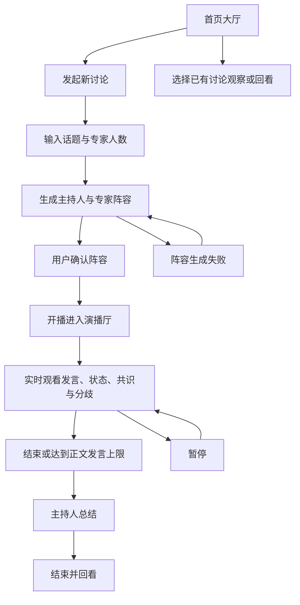

# 产品需求文档（PRD）

- **文档目的：** 固化 AI Panel Studio 的产品范围、用户需求、功能验收标准与非功能目标，作为设计、实现和测试的共同依据。
- **读者：** 产品与项目编排者、前后端开发代理、测试代理。
- **版本：** v1.0
- **关联文档：** `docs/ER.md`、`docs/API.md`、`docs/ARCHITECTURE.md`、`docs/prompts/01-sdd-docs.md`

## 1. 产品概述

### 1.1 产品定位

AI Panel Studio 是一款本地运行的「AI 圆桌讨论」Web 应用。用户输入讨论话题并指定专家人数（默认 4 人），系统调用大模型动态生成一位主持人与一组专家，展示嘉宾姓名、职业、Title、立场和专属颜色。用户确认阵容后进入演播厅，观看一场由 AI 驱动、实时推进的圆桌讨论。

### 1.2 核心价值主张

让任何人都能快速召集一支「虚拟智库」，围绕任意议题进行多角度碰撞：主持人开场、追问、串联与收尾，专家根据讨论内容自主举手、抢答、补充或反驳；共识与分歧在讨论进行中持续提炼，而非仅在结束时给出一个结论。

### 1.3 一句话场景

产品负责人输入「是否应该把 AI 助手引入客服」，确认系统生成的主持人与专家阵容后，观看不同立场的专家围绕真实发言展开即时辩论，并在演播厅中看到不断更新的观点、共识、分歧和主持人最终总结。

## 2. 目标用户画像与典型使用场景

| 用户群体 | 特征描述 | 核心诉求 | 典型使用场景 |
|---|---|---|---|
| 知识工作者与研究人员 | 需要快速审视议题的多个方面，时间有限 | 在几分钟内获得不同视角的深度分析与争辩摘要 | 研究人员输入一个新兴技术议题，观察专家从技术、社会与伦理角度补充和反驳，最后回看共识与未决问题。 |
| 产品/决策人员 | 在方案评审或战略讨论前希望预演各方立场与潜在争议 | 借助 AI 圆桌发现盲点、检验假设，提升决策质量 | 产品负责人输入某项功能上线方案，邀请一组虚拟专家讨论收益、风险和实施条件，在正式评审前整理分歧。 |
| 教育与内容创作者 | 需要将复杂议题结构化呈现给受众，重视沉浸感与叙事性 | 获得一场可录制、可回放的「虚拟专家访谈」作为内容素材 | 教育创作者输入一个公共议题，观看专家对话并回看 Transcript 与主持人总结，作为后续内容策划素材。 |

## 3. 痛点与解决方案映射

| 用户痛点 | 产品解决方案 |
|---|---|
| 视角单一：单一 AI 对话往往立场单一，缺乏对抗性思考带来的深度。 | 动态生成具有不同立场标签的多名专家；专家可以针对 transcript 中真实出现的观点进行补充或反驳。 |
| 异步割裂：分别询问多个 AI 角色，上下文割裂，观点之间难以互动。 | 同一讨论共享精简、连续的 transcript 窗口；主持人串联发言，专家可回应前一位发言人，讨论上下文按讨论隔离。 |
| 过程不可见：AI 通常只给出最终结论，缺少观点演化的实时感。 | 通过 SSE 流式呈现现场发言、专家公开状态及关注点，并在过程中持续更新共识与分歧。 |
| 议题管理混乱：多个议题的上下文、进展与结论难以并行隔离。 | 首页集中展示讨论状态；每场讨论拥有独立状态、事件流、transcript、共识、分歧与运行引擎。 |

## 4. 功能需求

### F1. 首页大厅

- **优先级：** P0
- **用户故事：** 作为用户，我希望在首页看到正在进行及已有的讨论，以便加入观察或发起新议题。
- **交互要点：**
  - 列出讨论话题、状态、嘉宾、发言数和观众数；有最新发言时显示发言人和摘要。
  - 状态分组：`live`、`summarizing`、`paused` 属于直播中；`draft`、`lineup_ready`、`failed` 属于待开播；`ended` 属于往期回放。`paused` 要有「已暂停」标识。
  - 列表顺序按 `live > summarizing > paused > lineup_ready > draft > failed > ended`，同级按 `updatedAt` 倒序。
  - 用户可以进入讨论观察，也可以发起新讨论；观察已有讨论不应改变其状态。
- **验收标准：**
  - **AC-F1-1** — Given 系统中存在不同状态的讨论，When 用户打开首页，Then 页面按规定的三个状态分组展示所有讨论，并将 `paused` 标为「已暂停」。
  - **AC-F1-2** — Given 同一分组存在多场讨论，When 首页载入列表，Then 同状态讨论按 `updatedAt` 倒序排列。
  - **AC-F1-3** — Given 有一场 `live` 讨论，When 用户选择观察，Then 用户进入该讨论的演播厅并可接收该讨论的实时更新，且不改变讨论状态。
  - **AC-F1-4** — Given 用户位于首页，When 用户选择新建讨论，Then 系统显示话题与专家人数输入界面。

### F2. 嘉宾生成与阵容确认

- **优先级：** P0
- **用户故事：** 作为用户，我希望针对话题生成一组具有差异化立场的主持人与专家，并在开播前确认或重新生成阵容。
- **交互要点：**
  - 话题修剪后为 2–200 字；专家人数为 2–6，默认 4，人数不包括主持人。
  - 创建讨论时同步请求模型生成阵容。主持人与专家均展示姓名、职业、Title、立场、短立场标签及专属颜色。
  - 主持人为 seat 0，专家 seat 从 1 起；颜色由代码分配。主持人为 `#E8C872`，专家按 seat 使用固定调色板。
  - 用户确认阵容后才可开播；在 `lineup_ready` 状态可「换一批」。
  - 阵容生成失败时讨论保留为 `failed`，显示中文错误并允许重新生成；不展示模型 JSON 原文。
- **验收标准：**
  - **AC-F2-1** — Given 用户输入修剪后少于 2 字、超过 200 字的话题或 2–6 之外的专家人数，When 用户提交，Then 系统拒绝请求并显示可直接理解的中文校验错误。
  - **AC-F2-2** — Given 用户未填写专家人数，When 用户提交有效话题，Then 系统按 4 名专家创建讨论并生成主持人阵容。
  - **AC-F2-3** — Given 阵容生成成功，When 用户查看确认页，Then 页面显示 1 位主持人与指定人数的专家，各自包含姓名、职业、Title、立场、立场标签和专属颜色。
  - **AC-F2-4** — Given 讨论处于 `lineup_ready`，When 用户选择「换一批」，Then 系统重新生成并返回完整新阵容，讨论仍为 `lineup_ready`。
  - **AC-F2-5** — Given 阵容生成连续失败，When 服务器结束本次生成，Then 讨论状态为 `failed`，中文错误可见，且用户可以重试而无需重新输入话题。
  - **AC-F2-6** — Given 阵容已生成，When 用户查看页面或 API 响应，Then 页面展示结构化嘉宾信息而不是模型 JSON 原文。

### F3. 演播厅主流程

- **优先级：** P0
- **用户故事：** 作为观众，我希望看到主持人与专家根据实际讨论内容实时推进圆桌，而不是机械地按座位轮流发言。
- **交互要点：**
  - 用户确认阵容后开播；引擎先由主持人开场，再循环执行主持人策略或专家出价与调度。
  - 专家可以举手、抢答、补充、反驳；主持人可追问、串联或点名。选择依据是意愿、意图、紧急度、回应关系、公平性等调度规则，不是固定轮转。
  - 专家与主持人插话每次最多 2 句；开场最多 3 句；总结不限句数。正文发言达到 `maxTurns` 时进入总结。
  - 「暂停」等当前发言结束后停住；「继续」恢复；「结束」进入总结。已暂停讨论可继续或结束。
  - 发言以 SSE 流式呈现，最终文本以持久化的 `utterance.completed` 为准。
- **验收标准：**
  - **AC-F3-1** — Given 阵容状态为 `lineup_ready`，When 用户开播，Then 状态转换为 `live` 且主持人先进行开场。
  - **AC-F3-2** — Given 演播厅正在运行且存在专家出价，When 引擎选择下一位专家，Then 选择由出价与调度规则决定，不因 seat 顺序而机械轮流，且上一条发言为专家时同一专家不会连续发言两次。
  - **AC-F3-3** — Given 一条发言正在生成，When 模型返回内容增量，Then 演播厅实时显示增量，并在发言完成后以最终 Transcript 文本替换流式文本。
  - **AC-F3-4** — Given 用户请求暂停，When 当前发言完成，Then 讨论进入 `paused` 并停止产生下一条发言；用户请求继续后恢复为 `live`。
  - **AC-F3-5** — Given 正文发言数达到 `maxTurns` 或用户在 `live`/`paused` 状态请求结束，When 引擎开始总结，Then 讨论进入 `summarizing`，总结完成后进入 `ended`。
  - **AC-F3-6** — Given 开场、正文与总结发言，When 系统写入 Transcript，Then 开场最多 3 句，专家及主持人插话最多 2 句，总结不限句数；正文 `turnCount` 不包含开场和总结。

### F4. 专家状态小窗

- **优先级：** P0
- **用户故事：** 作为观众，我希望看到每位专家的公开运行状态和关注点，以了解讨论正在如何推进。
- **交互要点：**
  - 每名专家有独立状态小窗，状态为 `idle`（待机）、`preparing`（准备发言）或 `speaking`（发言中）。
  - `preparing` 时可展示意图：`raise_hand`、`interrupt`、`supplement` 或 `rebut`；其他状态下意图为 `null`。
  - 关注点来自出价任务的公开 `focus` 字段，最多 40 字；它不是隐藏推理过程。
  - 不得读取、展示或推送 `reasoning_content` 或真实隐藏 chain-of-thought。
- **验收标准：**
  - **AC-F4-1** — Given 某专家状态发生变化，When 收到 `participant.state` 事件，Then 该专家的小窗立即显示对应的 `idle`、`preparing` 或 `speaking` 状态。
  - **AC-F4-2** — Given 专家处于 `preparing`，When 事件带有合法意图与关注点，Then 小窗显示意图和不超过 40 字的公开关注点；未提供关注点时不显示空内容。
  - **AC-F4-3** — Given 任意模型响应含 `reasoning_content`，When 后端处理响应，Then 该字段不会出现在小窗、SSE、存储内容或日志中。

### F5. 实时共识与分歧

- **优先级：** P0
- **用户故事：** 作为观众，我希望在讨论进行中看到专家的共同观点与真实分歧持续更新。
- **交互要点：**
  - 洞察从已有发言中提炼，按 `consensus`（共识）和 `divergence`（分歧）展示。
  - 洞察更新异步执行，不阻塞演播厅主循环；前端收到 `insights.updated` 后整体替换当前条目。
  - 洞察需要至少两位专家和有效发言证据；分歧化解后标为已化解。
  - 每类最多保留 6 条，按最近更新时间对应的发言序号排序保留。
- **验收标准：**
  - **AC-F5-1** — Given 出现已完成的正文发言，When 洞察队列提炼并成功持久化变化，Then 演播厅收到 `insights.updated` 并显示当前全部共识与分歧。
  - **AC-F5-2** — Given 一条模型洞察少于两位专家或没有有效 evidence 发言序号，When 后端校验该洞察，Then 不将该条写入或展示。
  - **AC-F5-3** — Given 分歧状态由模型标记为已化解且补丁有效，When 系统合并洞察，Then 该条状态变为 `resolved`，并在界面标为「已化解」。
  - **AC-F5-4** — Given 洞察模型请求失败，When 主循环继续运行，Then 主循环不被阻塞，遗漏发言可在下一次洞察触发时一并处理。

### F6. 现场 Transcript

- **优先级：** P0
- **用户故事：** 作为观众，我希望按时间顺序阅读完整发言，并能快速识别发言人和其职业/Title。
- **交互要点：**
  - 显示发言人姓名、职业/Title、发言内容及与发言人一致的颜色标识。
  - 通过 participant 与 utterance 的关系展示人员信息，按讨论内 `seq` 顺序排列。
  - 不显示「举手」等内部事件、出价或 `participant.state` 事件作为发言条目。
  - 最新发言到达时滚动区域可定位到新内容；用户主动阅读历史时不强制打断其滚动位置。
- **验收标准：**
  - **AC-F6-1** — Given 收到一条 `utterance.completed`，When 演播厅更新 Transcript，Then 按其 `seq` 显示姓名、职业/Title、同嘉宾一致的颜色和最终发言文本。
  - **AC-F6-2** — Given 某专家产生 `raise_hand` 或其他出价意图，When SSE 推送对应状态，Then Transcript 不新增一条「举手」或内部意图记录。
  - **AC-F6-3** — Given 观众加入已有讨论，When 首屏快照返回历史发言，Then Transcript 按时间正序呈现已有记录。

### F7. 主持人总结

- **优先级：** P0
- **用户故事：** 作为用户，我希望讨论结束时获得自然语言总结，以便快速回顾结论、分歧与讨论重点。
- **交互要点：**
  - 主持人以自然语言完成 3–5 段总结；讨论进入 `summarizing` 后等待洞察队列清空。
  - 总结作为 `summary` 保存并通过 `summary.completed` 推送；关闭发言记录为 `closing`。
  - 页面不得直接显示 JSON 原文、代码块或表格形式的模型总结；若模型总结失败，后端重试一次并以代码模板生成自然语言兜底总结。
- **验收标准：**
  - **AC-F7-1** — Given 讨论进入 `summarizing`，When 主持人总结成功，Then 系统保存自然语言总结、推送 `summary.completed` 并将讨论状态更新为 `ended`。
  - **AC-F7-2** — Given 总结模型返回以 `{` 或 `[` 开头或可被 JSON 解析的内容，When 后端校验总结，Then 将其视为失败并重试或采用兜底总结，不向页面显示 JSON。
  - **AC-F7-3** — Given 总结调用两次均失败，When 后端执行兜底，Then 页面仍得到基于当前共识与分歧生成的自然语言总结。

### F8. 导出实录 Markdown

- **优先级：** P1
- **用户故事：** 作为用户，我希望将一场讨论的实录导出为 Markdown，以便离线保存或整理内容。
- **交互要点：**
  - 用户可从讨论快照导出话题、嘉宾阵容、按序 Transcript、当前共识与分歧及总结。
  - 导出由客户端使用已有完整讨论快照生成文件，不新增 REST 接口、数据库字段或 SSE 事件；不导出内部意图、隐藏思维链、API Key 或错误堆栈。
  - 此功能优先级为 P1，纳入首个交付范围；不改变 P0 讨论创建、观看和回放的核心闭环。
- **验收标准：**
  - **AC-F8-1** — Given 用户打开一场可回看的讨论且完整快照已载入，When 用户选择导出，Then 浏览器生成包含话题、阵容、Transcript、洞察与总结的 Markdown 文件。
  - **AC-F8-2** — Given 导出文件已生成，When 用户检查其内容，Then 条目按 `seq` 排序，且不包含举手等内部事件、隐藏思维链或密钥。

## 5. 非功能需求

| 类别 | 需求与目标 |
|---|---|
| 密钥与模型输出安全 | 大模型 API Key 仅由后端从环境变量读取；不进入浏览器或 API 响应。`/api/health` 仅返回提供商名和模型名。日志不记录 Key 或推理内容。`reasoning_content` 不存储、不推送、不展示。 |
| 并行隔离 | 支持多个讨论并行运行；各讨论的状态、Runner、事件流、Transcript、共识、分歧、随机数与暂停信号互相隔离。只有模型并发上限是全局共享资源。 |
| 实时性 | 使用 SSE 更新状态、字幕、洞察和观众数。目标是在真实模型条件下首个字幕 ≤ 3 秒出现、相邻单条发言间隔 3–8 秒；这是性能目标，受模型响应和网络影响，需在实际环境中测量。 |
| 响应式布局 | 页面整体不滚动，各区域在自身容器内独立滚动。超宽屏为 ≥ 1600px，桌面为 1024–1599px，窄屏为 < 1024px；三个档位均需合理分配或重排区域。 |
| 中文 UI | 面向用户的主要界面文案、校验错误和可展示错误为简体中文。嘉宾字段可包含 Title，但页面周边 UI 使用中文。 |
| 可测试性 | 内置确定性 `mock` 提供商，供单元、集成、E2E 与无 Key 演示使用；E2E 不依赖真实大模型。 |
| 可观测性 | 记录任务、模型、耗时与 token 用量等运行指标；日志不得记录 API Key、模型隐藏推理或不必要的讨论内容。 |
| 本地运行与持久化 | 前后端分离并可本地运行；数据采用 SQLite；Node.js、端口、代理与模型配置见 `docs/ARCHITECTURE.md`。 |

## 6. 核心用户流程

## 7. 范围外与后续迭代

- 本版本面向本地运行，不定义账号体系、云端同步、跨设备身份、远程托管或计费。
- 本版本以文本圆桌为核心，不包含语音合成、语音识别、视频会议或真实嘉宾连线。
- 专家阵容由模型生成；用户确认或换一批，不包含手动编辑角色卡、邀请真人或管理外部身份。
- 实时讨论以观看为主，不提供观众插入发言、改变专家出价或投票控制讨论的能力。
- Markdown 导出为 P1 功能，纳入首个交付范围。
- 账号、云端协作、语音/视频、人工编辑角色卡与更丰富的导出格式可作为后续迭代评估。

## 8. 术语表

| 术语 | 定义 |
|---|---|
| 举手（`raise_hand`） | 专家表达希望在常规发言机会中发言的内部出价意图，不是 Transcript 条目。 |
| 抢答（`interrupt`） | 专家对当前讨论表达更高紧急度的出价意图；它只通过公开状态事件呈现，不作为独立发言条目。 |
| 补充（`supplement`） | 专家希望补充已有观点的出价意图。 |
| 反驳（`rebut`） | 专家希望针对讨论中已出现的观点提出反向论证的出价意图。 |
| 正文发言 | 开场 `opening` 与总结 `closing` 以外的已完成讨论发言；`turnCount` 包含正文专家发言及主持人插话，不包含开场和总结。 |
| 共识（`consensus`） | 至少两名专家认同、且由有效发言序号提供证据的共同观点。 |
| 分歧（`divergence`） | 至少两名专家之间存在不同立场、且由有效发言序号提供证据的观点；化解后状态为 `resolved`。 |
| 公开关注点（`focus`） | 专家出价任务单独生成、面向观众的一句话关注点，最多 40 字；不是隐藏 chain-of-thought。 |
| Transcript | 按讨论内 `seq` 排序的已完成发言记录。 |
| 持久事件 | 先写入 `events` 表、带事件序号 `id`，可用于断线补发与回放的 SSE 事件。 |
| 瞬时事件 | 不入库、不带 SSE `id` 的即时状态或流式片段事件。 |
| 演播厅 | 用户确认阵容后进入的实时讨论界面，展示专家状态、Transcript、共识与分歧及总结。 |
