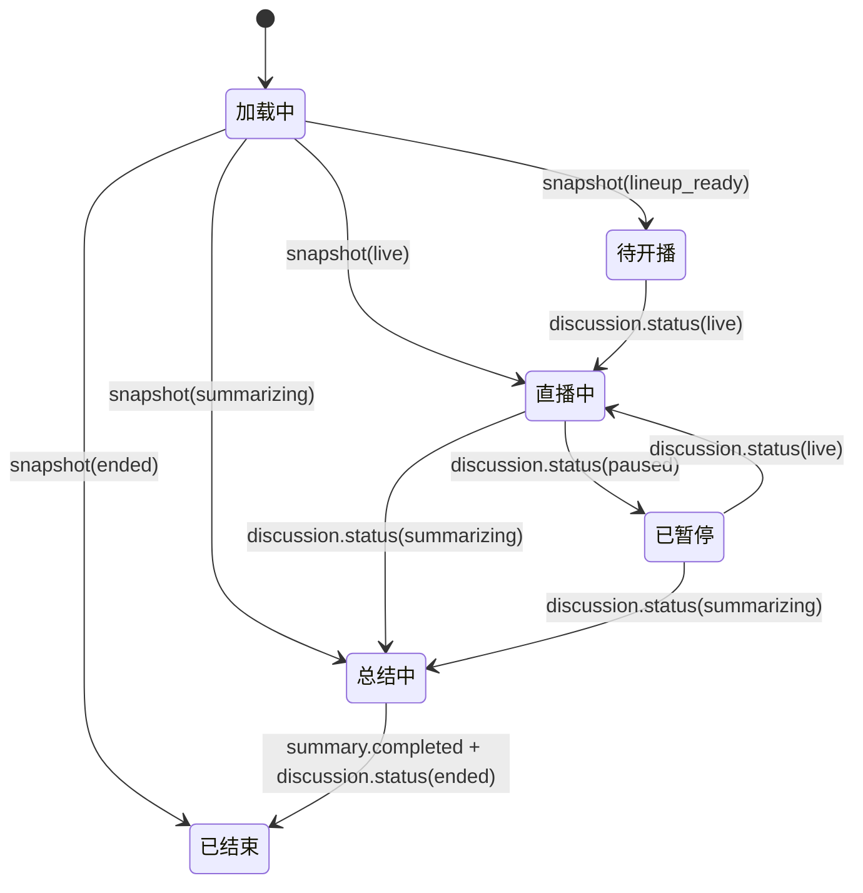
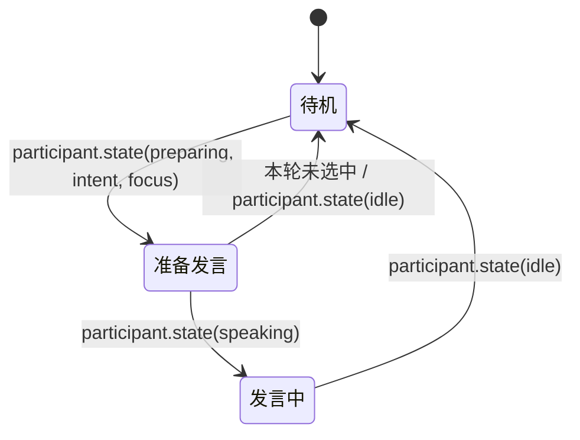

# AI Panel Studio · UI Design

## 1. 设计理念

**深夜演播厅**：以观众视角呈现一场正在发生的电视圆桌。界面像控制室而不是传统后台：深墨色演播空间承接两束柔和聚光，嘉宾是有色温、有状态的小窗；字幕条让正在说的话成为舞台中心，Transcript 留住已经发生的内容，共识与分歧则像节目侧栏一样持续更新。

关键词：**聚光、在播、字幕条、席位、实时**。高频信息优先保证可读性，装饰只服务层级；共识始终使用绿，分歧始终使用橙，主持人与席位专属色不随页面变化。

## 2. 设计令牌

### 2.1 色彩与表面

| 令牌 | 值 | 用途 |
|---|---|---|
| `ink-950` | `#05070D` | 页面底色 |
| `ink-900` | `#0A0E17` | 深层容器 |
| `ink-850` | `#0D121D` | 演播台与卡片底色 |
| `glass` | `rgba(255,255,255,0.04)` | 深色玻璃面板 |
| `glass-border` | `rgba(255,255,255,0.08)` | 面板描边 |
| `text-primary` | `#E6E8EE` | 标题、正文、字幕 |
| `text-secondary` | `#9AA3B2` | 描述、Title、辅助信息 |
| `text-muted` | `#5C6575` | 仅用于不承载信息的装饰性标签 |
| `live` | `#FF3B5C` | LIVE、直播状态与脉冲 |
| `consensus` | `#3DDC97` | 共识、正向汇聚 |
| `divergence` | `#FF9F43` | 分歧、待讨论张力 |
| `host` | `HOST_COLOR` (`#E8C872`) | 主持人席位与主持人发言 |
| `expert` | `EXPERT_PALETTE` | 专家席位、发言条与立场色点 |

全局底层使用 `#05070D`，叠加左上蓝灰与右下紫灰两束低透明度径向聚光；聚光不能降低文字对比度。正文与信息性辅助文字按 WCAG 计算至少达到 4.5:1；Title、关注点、Transcript 次要信息和总结正文使用可读的主/次文字色，`#5C6575` 只用于装饰性标签。面板为 `rgba(255,255,255,0.04)`、1px `rgba(255,255,255,0.08)`、16px 圆角与轻量 `backdrop-filter: blur(16px)`。舞台容器可用额外内描边和顶部聚光，避免玻璃层互相吞并。

### 2.2 字体、字号与排版

- 字体栈：`"PingFang SC", "Microsoft YaHei", "Noto Sans SC", system-ui, sans-serif`。
- 数字、轮次、计数使用 `font-variant-numeric: tabular-nums`，避免更新时横向抖动。
- 字号阶梯：微型标注 10–11px；辅助信息 12px；正文 13–14px；面板标题 15–17px；页面标题 24–30px；演播厅话题 16–20px；字幕正文 18–24px。
- 标题使用紧凑行高；字幕与 Transcript 正文保持 1.65–1.8 行高。所有截断均保留完整内容的可访问名称或 title。

### 2.3 圆角、阴影与动效

- 圆角：控件 10px、卡片 14px、主面板 16px、胶囊 999px。
- 阴影：面板使用 `0 18px 54px rgba(0,0,0,.28)`；发言席位的专属辉光只在 speaking 状态出现，不以阴影代替状态文字。
- 动效：快速反馈 140ms、面板/Tab 过渡 220ms、状态强调 1.8s；缓动 `cubic-bezier(.2,.75,.25,1)`。
- 关键帧：`live-pulse`（直播红点）、`speaking-glow`（发言席位色辉光）、`sound-wave`（发言声波）、`slide-in`（新 Transcript 条目）、`flash`（洞察更新）。`prefers-reduced-motion` 下停用循环动画与位移动画，保留即时状态变化。

## 3. 布局与断点

### 3.1 全局规则

- 页面根节点占满 `100dvh`，`html/body/#root` 禁止整体滚动。
- 页面按顶栏和内容区分行；滚动内容的祖先必须允许收缩（`min-height: 0`），具体面板使用 `overflow: auto`。
- 大厅、新建页的主内容区独立滚动；演播厅 Transcript、洞察和窄屏 Tab 内容分别独立滚动。
- 断点依据 PRD：窄屏 `<1024px`；桌面 `1024–1599px`；超宽屏 `≥1600px`。

### 3.2 演播厅线框

**超宽屏 ≥1600px**（示例 2560×1080）：顶栏跨全宽，下方为三列；舞台优先，Transcript 固定 420px，洞察/总结固定 380px。直播和暂停时只显示洞察；总结中/结束后在同一列切换主持人总结与共识/分歧。洞察视图将共识、分歧上下堆叠，整列独立纵向滚动。

```text
┌──────────────────────────── StudioHeader ──────────────────────────────┐
│ 返回 · LIVE · 话题 · 第 n/max 轮 · 观众 · 连接 · 控制                  │
├──────────────────────────────────┬─────────────────────┬───────────────┤
│ StageArena + OnAirCaption         │ Transcript 420px     │ 总结 / 洞察 Tabs│
│ minmax(0, 1fr)                     │ 独立纵向滚动         │ 共识 / 分歧   │
│                                    │                     │ 堆叠、整列滚动 │
└──────────────────────────────────┴─────────────────────┴───────────────┘
```

**桌面 1024–1599px**（示例 1440×900）：顶栏跨全宽；左列上下组合舞台/字幕与洞察，右列 Transcript 固定 380px。直播、暂停时共识与分歧并排；总结中/结束后可在主持人总结与共识/分歧间切换。

```text
┌──────────────────────────── StudioHeader ─────────────────────────────┐
├────────────────────────────────────────────┬───────────────────────────┤
│ StageArena（上）                           │ Transcript 380px          │
│ OnAirCaption                               │ 独立纵向滚动              │
├────────────────────────────────────────────┤                           │
│ 洞察（下，左列约 40% 高度；共识 + 分歧并排）│                           │
└────────────────────────────────────────────┴───────────────────────────┘
```

**窄屏 <1024px**（示例 390×844）：紧凑顶栏始终保留 LIVE / 已暂停 / 已结束等状态徽标、横向滚动席位、字幕条、三项 Tab；Tab 内容占满剩余高度并在自身滚动。

```text
┌──── 返回 · 状态徽标 · 话题 · 控制 ───────┐
├──── Host + Guest Windows（横向滚动）─────┤
├──────────── OnAirCaption ─────────────────┤
├──── 实录 ───── 共识与分歧 ───── 总结 ─────┤
├──── 当前 Tab 内容（min-height:0）─────────┤
│            独立滚动                       │
└───────────────────────────────────────────┘
```

桌面列宽：超宽屏为 `minmax(0,1fr) 420px 380px`；普通桌面为 `minmax(0,1fr) 380px`。总结中/结束后，桌面洞察栏使用键盘可操作的 Tabs，默认选中“主持人总结”；切换到“共识与分歧”可查看真实洞察条目，底部共识/分歧计数可直接打开该视图，导出实录和返回大厅操作始终可见。直播、暂停时不显示这些切换项。超宽屏洞察栏将共识和分歧分组纵向堆叠，并由同一内容区独立滚动；1440px 洞察面板仍左右并排。超宽屏舞台列作为尺寸容器，以 `cqw` / `cqh` 按舞台尺寸放大主持席、头像、字号与专家小窗；专家小窗显示公开立场陈述以及按讨论/专家状态呈现的关注点行。舞台列宽不超过 900px 时，专家职业与 Title 可换行，避免单行省略。1440 桌面与窄屏保留原舞台列布局。窄屏字幕条将标签与“头像 + 姓名 + 职业”发言人信息排在首行，字幕文本另占一行；各行由顶栏、席位条、字幕、Tab 和剩余高度组成，避免固定高度造成视口溢出。

### 3.3 大厅与新建页

```text
大厅：100dvh = 顶栏（约 68px） + 可滚动主区（英雄区 / 分组 Tabs / 讨论卡片）
新建：100dvh = 顶栏（约 68px） + 可滚动主区（话题表单 / 生成态 / 阵容确认）
```

桌面主内容设置舒适的最大宽度并使用两列卡片；窄屏降为单列。只有内容区域滚动，顶栏固定可见；阵容确认卡片在可用空间内展示，超出部分仍由主内容区滚动，不允许页面本身滚动。

## 4. 组件清单

| 组件 | 职责 / props | 主要视觉状态 |
|---|---|---|
| `Button` | `variant`、`size`、`disabled`、children；主次操作统一入口 | 金色主操作、玻璃次操作、危险结束、禁用 |
| `IconButton` | `label`、icon、点击回调 | 默认、hover、键盘焦点、禁用 |
| `Badge` | `tone`、children；状态、立场和意图胶囊 | LIVE 脉冲、状态中性、共识绿、分歧橙 |
| `Panel` | `title`、`eyebrow`、actions、children | 玻璃面板、可滚动内容、紧凑面板 |
| `Avatar` | participant/brief、尺寸 | 专属色圆环、主持金环、席位头像字 |
| `Tabs` | items、active key、onChange、panel id、`data-testid` | `tablist` / `tab` / `tabpanel` 关联、`aria-selected`、方向键/Home/End 导航 |
| `Skeleton` | variant、数量 | 低对比 shimmer；reduced motion 下静态 |
| `EmptyState` | title、description、action | 分组为空、暂无发言、暂无洞察 |
| `ConfirmDialog` | title、description、confirm/cancel 文案 | 模态、焦点圈定、危险操作强调 |
| `DiscussionCard` | `DiscussionListItem`、进入回调 | 直播/待开播/回放徽标、嘉宾串、摘要、hover |
| `LobbyGroupTabs` | `LOBBY_GROUPS`、各组数量、当前 key | 稳定 key 查询参数、选中态、零数量 |
| `TopicForm` | 初始 topic/count、提交、校验、示例选择 | 字数提示、校验错误、人数 2–6 |
| `GuestCard` / `HostCard` | `Participant`、阵容操作 | 专属色条、立场 Tag、主持金色卡片 |
| `LineupReview` | snapshot、regen/start callbacks | 完整阵容、生成中、可重试错误 |
| `LineupSkeleton` | placeholder 数量 | 头像与席位卡 shimmer |
| `StudioHeader` | state、connection、control handlers | live / paused / summarizing / ended |
| `StageArena` / `HostSeat` | participants、live speaker | 主持人主位、专家小窗、桌面网格/窄屏横条 |
| `ExpertStatusWindow` | participant、speaking、discussion status | 公开立场陈述（超宽屏）；focus 存在时始终显示；live 且 idle、无 focus 时显示“正在聆听”，live 且 speaking、无 focus 时显示“正在发言”；非 live 状态无 focus 时隐藏关注点行；preparing 意图徽标、speaking 专属辉光与声波；不展示推理过程 |
| `OnAirCaption` | 当前 participant、live text、discussion status | 彩色发言人标识、打字文字与光标；paused 显示“讨论已暂停”，ended 显示“讨论已结束” |
| `TranscriptPanel` / `TranscriptItem` | utterances、participants、auto-follow | seq 顺序、主持金色、新条目滑入、上翻提示 |
| `InsightsPanel` / `InsightItem` | insights、participants、update token | 共识绿、分歧橙、专家色点、已化解弱化、高亮 |
| `StudioDesktopPanel` | snapshot、洞察更新版本、返回回调 | live/paused 仅洞察；总结中/结束后总结与洞察切换、计数跳转 |
| `SummaryPanel` / `SummaryPanelFooter` | status、summary、insights、导出/切换/返回回调 | 总结中流式、结束后段落、可切换计数、始终可见操作 |
| `ConnectionBadge` | `connecting/open/reconnecting` | 中文连接状态、不同色点 |
| `LobbyPage` | mock API 数据与筛选状态 | 分组大厅、空状态 |
| `NewDiscussionPage` | 表单、生成与阵容确认状态 | 输入、骨架、确认阵容、失败可重试 |
| `StudioPage` | discussion id、snapshot、事件源 | 实时直播、窄屏 Tab、总结回放 |

## 5. 状态流转与事件映射

### 5.1 演播厅页面



### 5.2 嘉宾小窗



### 5.3 十种事件到 UI 的映射

| 事件 | UI 变化 |
|---|---|
| `discussion.status` | 更新状态徽标、轮次进度、Studio 页面状态；ended 时停止直播态并展示总结 |
| `lineup.updated` | 整体替换主持人与专家席位卡 |
| `participant.state` | 更新小窗状态、意图、公开 focus；绝不显示隐藏推理内容 |
| `utterance.started` | 建立当前字幕与发言者聚光；Transcript 不新增内部状态条目 |
| `utterance.delta` | 仅累积到匹配的当前 live utterance，实时更新字幕/总结和光标 |
| `utterance.completed` | 以最终文本结束流式状态，按 seq 去重追加 Transcript |
| `insights.updated` | 整体替换共识/分歧，更新/新增条目短暂高亮 |
| `summary.completed` | 更新主持人自然语言总结；按空行分段，不序列化 JSON |
| `viewers.updated` | 刷新观看人数 |
| `error` | 显示受控中文提示与连接/错误徽标，不展示堆栈或模型原文 |

## 6. 交互细节

- **流式字幕：** `utterance.started` 锁定发言人；`utterance.delta` 仅在 `utteranceId` 匹配时追加；显示闪烁光标。收到 `utterance.completed` 后由持久最终文本替换流式文本。
- **Transcript 跟随：** 用户位于底部时新条目自动跟随；若用户向上阅读历史，保留其位置并显示「有新发言 ↓」，点击后滚到底部。只呈现 completed utterances，不将举手、抢答、出价意图伪装成发言。
- **洞察更新：** 新增/更新的共识或分歧高亮约 2 秒；resolved 分歧显示「已化解」且降低饱和度，不删除证据内容。
- **聚光：** speaking 席位使用嘉宾专属色辉光与轻微缩放；preparing 使用琥珀呼吸边框；idle 降低不透明度但仍保持文字可辨识。主持人沿用主持金色。
- **字幕状态文案：** paused 时字幕条显示“讨论已暂停”，ended 时显示“讨论已结束”，不会退回“等待下一位发言…”；非暂停/结束且没有 live utterance 时使用等待占位。
- **状态控制：** `lineup_ready` 可开播；`live` 可暂停或请求结束；`paused` 可继续或结束。结束是不可逆操作，二次确认。
- **结束与导出：** `summarizing` 时显示主持人流式总结；`ended` 显示自然语言段落、最终共识/分歧计数、Markdown 导出和返回大厅入口。导出快照含话题、阵容、按 seq 排序的实录、洞察和总结。
- **窄屏：** 顶栏显示 LIVE / 已暂停 / 已结束等状态徽标；字幕条首行并排显示字幕标签和发言人（头像、姓名、职业），下一行显示字幕。Tab 为「实录 / 共识与分歧 / 总结」，查询状态不覆盖运行状态；顶部嘉宾条可横向滚动，Tab 面板不带动整页滚动。

## 7. 可访问性

- 正文及承载信息的辅助文字与背景对比度至少为 4.5:1（WCAG）；`#5C6575` 只用于装饰性标签，总结段落使用主文字色并保持至少 1.85 行高。颜色不是唯一状态线索，LIVE、已暂停、准备发言、已化解等均有文字标签。
- On-air 字幕容器使用 `aria-live="polite"`；流式更新避免重复播报整段历史，Transcript 使用有序列表语义。
- 所有操作可通过键盘到达；按钮提供可理解的中文名称；Dialog 打开后聚焦标题/首个操作并将焦点留在对话框内，关闭后还原焦点。
- Tab 使用 `tablist` / `tab` / `tabpanel` 语义、可见焦点样式，并支持方向键切换。
- `prefers-reduced-motion: reduce` 时关闭呼吸、脉冲、声波、闪烁光标和位移过渡；状态仍可通过文字与颜色辨认。
